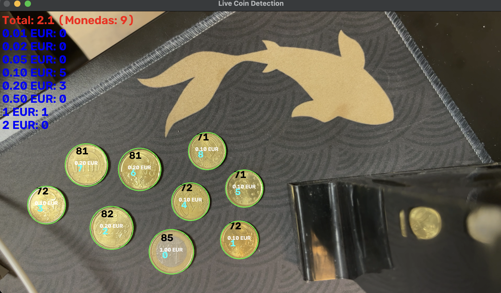
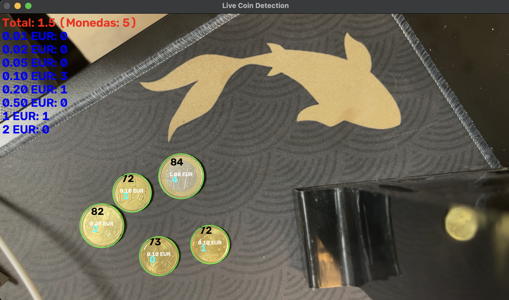
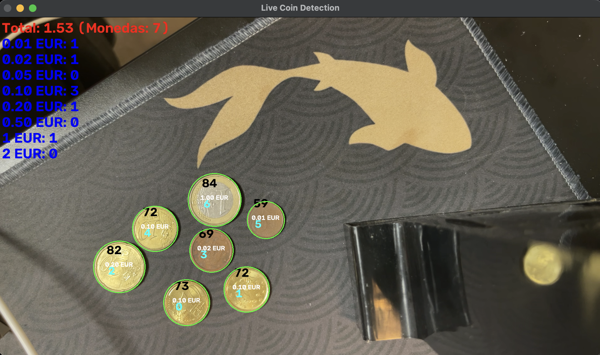
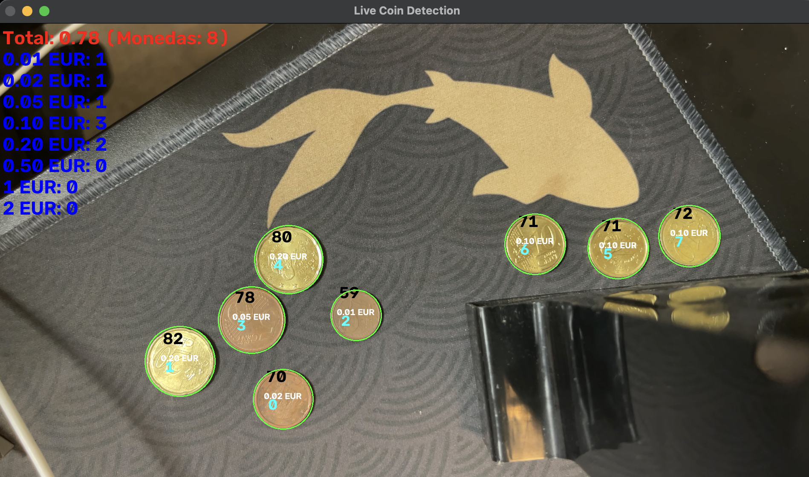
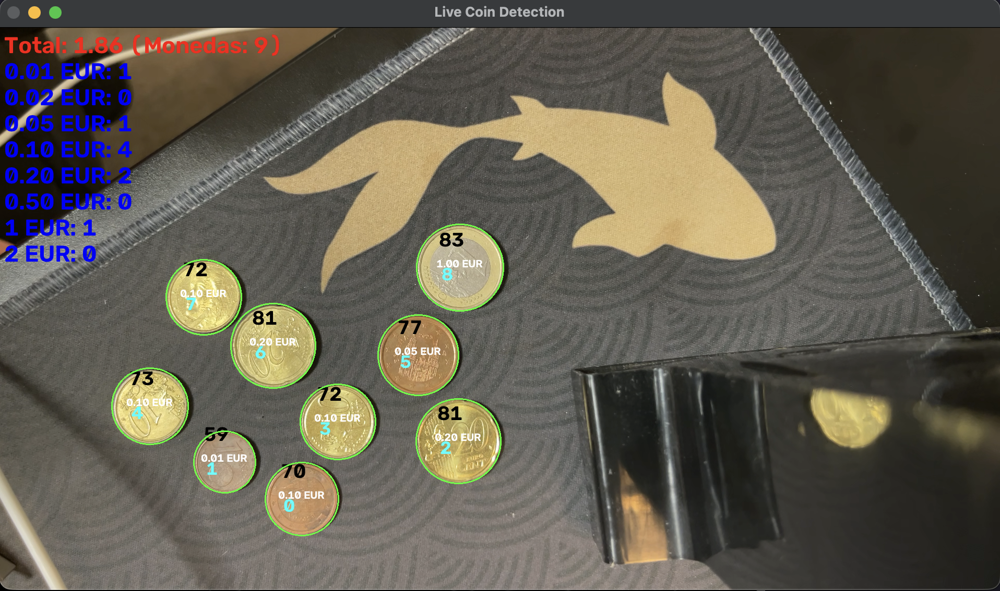
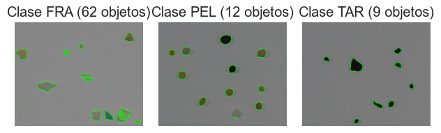
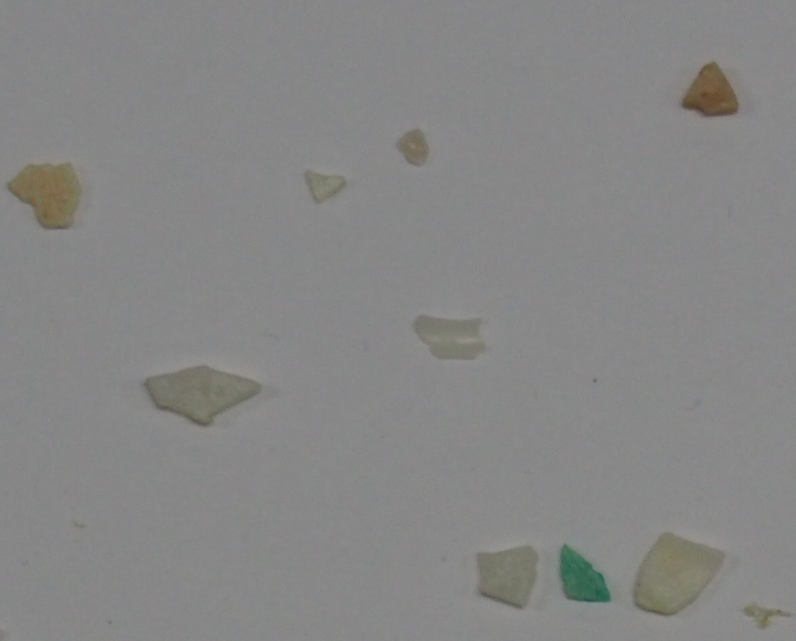
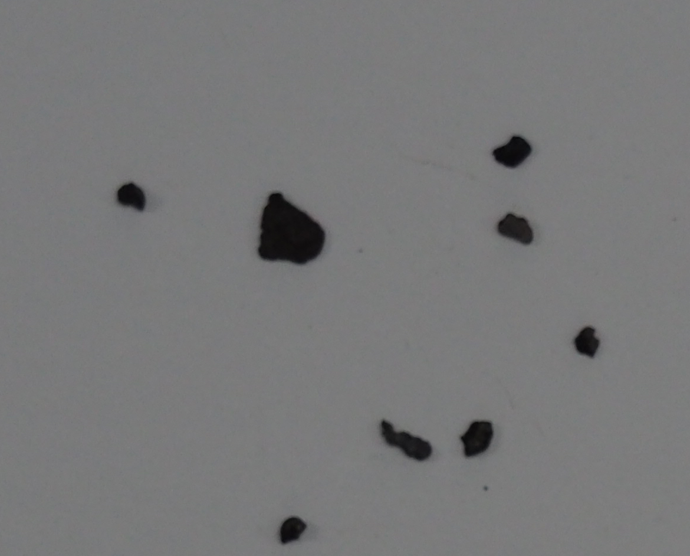
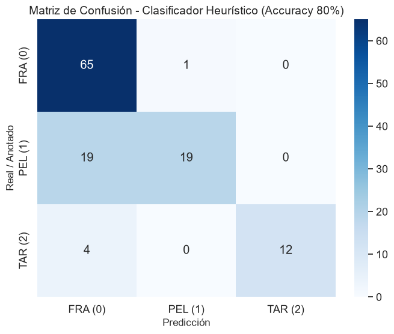

# Práctica 3 de Visión por Computador

> Autores: Félix Miguel Velásquez, Cristina Santana Martín

Implementación de dos problemas de visión artificial usando OpenCV y métodos clásicos, sin modelos de aprendizaje profundo:

1. Detección, clasificación y conteo de monedas.
2. Extracción de características y clasificación heurística de microplásticos.

La implementación completa se encuentra en [`VC_P3_FMV_CSM.ipynb`](./VC_P3_FMV_CSM.ipynb). También se incluyen versiones separadas de cada tarea en [`notebooks/`](./notebooks/).

## Dependencias

```bash
pip install opencv-python numpy matplotlib pandas seaborn scikit-learn
```

El cuaderno debe ejecutarse desde el directorio `P3`, ya que las imágenes y el CSV se cargan mediante rutas relativas.

---

## Tarea 1: detección y conteo de monedas

### Objetivo

Determinar cuántas monedas aparecen en una imagen, identificar su valor y calcular el dinero total. 
Después, el mismo procedimiento se adapta a una sequencia de imagen en vivo.

### Resolución

La solución utiliza únicamente procesamiento clásico:

1. La imagen se convierte a escala de grises y se suaviza con un filtro gaussiano.
2. Se detectan los bordes con **Canny**.
3. Los bordes se dilatan con un kernel 3x3 para cerrar pequeños huecos.
4. Se extraen los contornos externos y se filtran por área.
5. Cada contorno se aproxima mediante su círculo mínimo y se obtiene su diámetro en píxeles.
6. El usuario selecciona una moneda de 1 € para calibrar la escala:

```text
escala (mm/píxel) = 23.25 mm / diámetro observado de la moneda de 1 € en píxeles
```

7. El diámetro de cada moneda se transforma a milímetros y se asigna al valor
   cuyo diámetro oficial sea más próximo. La tabla utilizada en el cuaderno
   contiene las ocho monedas del euro:
   `0.01`, `0.02`, `0.05`, `0.10`, `0.20`, `0.50`, `1` y `2` euros.

En la imagen de prueba ideal se detecta una moneda de cada denominación.
La calibración registrada usa una moneda de 1 € de 192 píxeles, equivalente a `0.1211 mm/píxel` (`8.26 píxeles/mm`).
Por tanto, el valor real detectado es **3.88 € en 8 monedas**. 
El mensaje de depuración del cuaderno muestra `388.00 €` porque acumula internamente el importe en céntimos antes de convertirlo a euros para la salida del demostrador. Esto evita cualquier error de suma en coma flotante a la hora del conteo.

### Demostrador en vivo

`run_live_coin_detection()` abre la cámara, muestra la imagen capturada, permite elegir la moneda de referencia y actualiza en cada fotograma:

- El total acumulado
- El número de monedas detectadas
- El recuento por categoria
- Los contornos y la etiqueta estimada de cada moneda

Ejemplos de funcionamiento:





### Evaluación y problemas observados

El demostrador funciona correctamente cuando las monedas están separadas, visibles y aproximadamente en el mismo plano que la moneda usada para
calibrar. Las imágenes muestran que es capaz de contar monedas de distintos valores y actualizar el total en tiempo real.

Sin embargo, la solución tiene limitaciones propias de la detección por contornos:

- La escala depende de una calibración manual y de que la referencia y las monedas estén a una distancia similar de la cámara
- Los reflejos, las sombras y los bordes del escenario pueden generar contornos adicionales
- Las monedas parcialmente ocultas o solapadas dejan de ser círculos completos y pueden no detectarse o clasificarse con un diámetro incorrecto
- Objetos circulares que no son monedas pueden clasificarse como una denominación válida si poseen una circumferencia aparente válida
- Una cámara con baja calidad o no nivelada causa distorciones de perspectiva que influyen en el resultado de detección 
- En condiciones difíciles se observan errores de conteo y de valor, como en la prueba de fallo siguiente:



A causa de esto, el método es apropiado como demostrador sin aprendizaje profundo, pero necesitaría una segmentación más robusta, control de
perspectiva o una validación temporal entre fotogramas para utilizarse en un entorno real.

---

## Tarea 2: clasificación de partículas de microplástico

### Objetivo

Extraer características de las clases **FRA** (fragmentos), **PEL** (pellets) y **TAR** (alquitrán), y clasificar las partículas de `MPs_test.jpg` usando las anotaciones de `MPs_test_bbs.csv`, sin redes neuronales ni modelos de aprendizaje profundo.

### Segmentación y datos

Se emplea umbralización de Otsu sobre imágenes en escala de grises y se extraen los contornos de las regiones de interés definidas por el CSV.
Las imágenes de entrenamiento contienen:



- **FRA:** 62 objetos
- **PEL:** 12 objetos
- **TAR:** 9 objetos

El conjunto de entrenamiento produce **83 muestras** y el conjunto de test contiene **120 anotaciones**, todas procesadas por la función de extracción.
Las máscaras de cada clase pueden consultarse por separado:

| Clase | Ejemplo |
| --- | --- |
| Fragmentos (FRA) |  |
| Pellets (PEL) |  |
| Alquitrán (TAR) |  |

La segmentación es especialmente sencilla para TAR, por su contraste oscuro con el fondo.
En cambio, los pellets translúcidos suelen producir contornos incompletos o con forma de anillo. Para evitar perder estas muestras, se
implementa un respaldo basado en el *bounding box* cuando el área segmentada es demasiado pequeña respecto a la caja del objeto.

### Características utilizadas

La función `extract_features_final` genera ocho descriptores:

1. Compacidad.
2. Relación de aspecto de la caja delimitadora.
3. Solidez.
4. Extensión.
5. Media de escala de grises.
6. Media del tono (`H`).
7. Media de saturación (`S`).
8. Media del brillo (`V`).

El área y el perímetro absolutos se descartan porque dependen del zoom entre las imágenes de entrenamiento y de test. También se descartan las
características basadas en el ajuste de elipses y en las distancias al centroide, ya que son muy sensibles a los contornos incompletos de los
pellets. Se utiliza HSV porque el canal `V` permite distinguir de forma directa las partículas oscuras de alquitrán, mientras que `H` y `S` aportan
información sobre las partículas claras o translúcidas.

### Clasificador heurístico

La clasificación se realiza con reglas fijas:

```python
if V < 115 or gris < 130:
    TAR
elif compacidad < 1.7 and aspecto < 1.1 and solidez > 0.85:
    PEL
else:
    FRA
```

La prioridad de la primera regla evita etiquetar como pellet una partícula muy oscura. 
El resto de partículas regulares se considera pellet y las restantes se asignan a fragmentos.

### Resultados

Las métricas obtenidas sobre las 120 partículas de test son:

| Métrica | Resultado |
| --- | ---: |
| Accuracy | **80.00 %** |
| Precision ponderada | **84.04 %** |
| Recall ponderado | **80.00 %** |
| F1 ponderado | **78.60 %** |



De los 120 objetos, 96 se clasifican correctamente. El comportamiento por clase es:

- **FRA:** 65 de 66 aciertos. Sus formas irregulares y opacas se segmentan bien
- **TAR:** 12 de 16 aciertos. No se producen falsos positivos de TAR. Los cuatro errores se asignan a FRA, probablemente por reflejos o por el pequeño tamaño de algunas partículas
- **PEL:** 19 de 38 aciertos. Es la clase más difícil porque la transparencia impide recuperar siempre la geometría completa con Otsu: 19 pellets se confunden con fragmentos

### Conclusión

El algoritmo de deteción ha resultado ser fiable para identificar fragmentos y evita confundir partículas claras con alquitrán. El principal punto débil es la segmentación de pellets translúcidos, que limita su *recall* al 50 % en esa clase. Para mejorar el resultado sería necesario combinar iluminación controlada, segmentación específica para objetos transparentes y reglas menos dependientes de un único umbral.

## Bibliografia

- [Medidas de monedas de EURO](https://www.carm.es/web/pagina?IDCONTENIDO=718&IDTIPO=100&RASTRO=c285$m)
- [Detección de contornos de monedas](https://www.kaggle.com/code/mariamalkuwaiti/opencv-coin-detection-and-counting)
- [Detección mediante circulos de Hough](https://dev.to/tinazhouhui/coin-detection-discovering-opencv-with-python-1ka1)
- [Detección de imagenes estáticas de monedas](https://www.youtube.com/watch?v=_Coth4YESzk&list=UULFTiWJJhaH6BviSWKLJUM9sg)
- [Información sobre distintos tipos de umbralizado](https://www.luisllamas.es/opencv-umbralizacion-thresholding-adaptativo/)
- [SMACC: A System for Microplastics Automatic Counting and Classification](https://doi.org/10.1109/ACCESS.2020.2970498)
