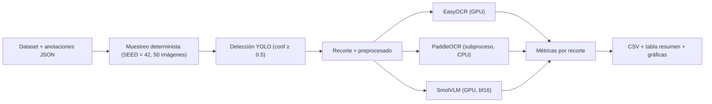
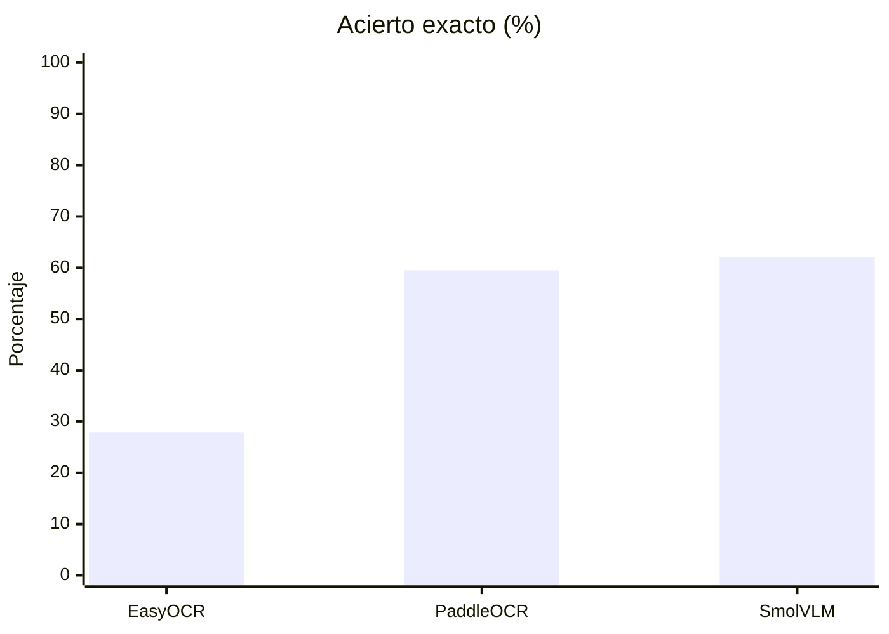
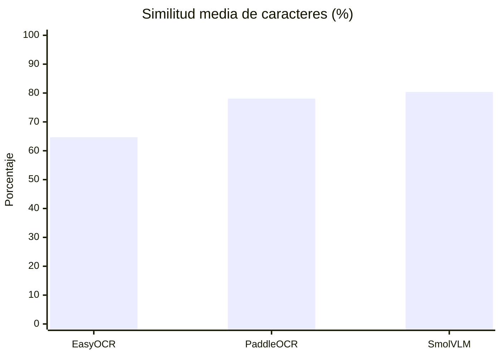
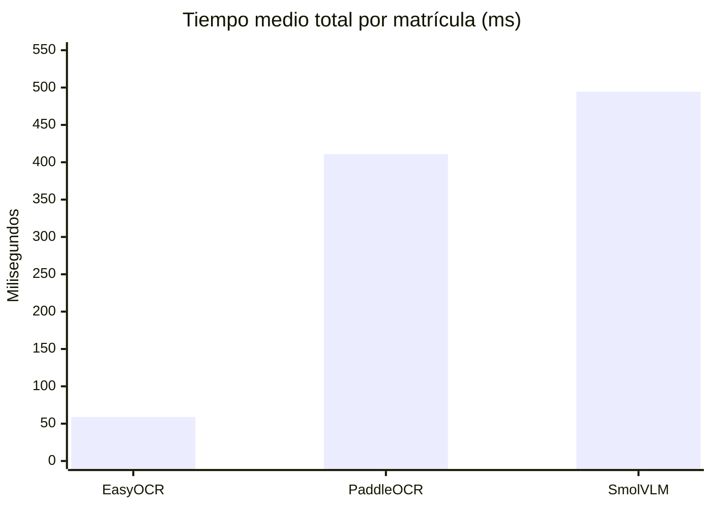

# Comparativa de OCR y VLM para lectura de matrículas

Este documento explica el trabajo realizado en
[`VC_P4B_CSM_FMV_comparative.ipynb`](./VC_P4B_CSM_FMV_comparative.ipynb) y
compara los resultados obtenidos por **EasyOCR**, **PaddleOCR** y **SmolVLM**
sobre los mismos recortes de matrícula detectados por YOLO.

Los resultados por recorte se guardan en
[`results/comparativa_resultados_parciales.csv`](./results/comparativa_resultados_parciales.csv).

---

## 1. Qué se hizo en el notebook

### 1.1 Entorno y reproducibilidad

- Semilla global `SEED = 42` para `random`, `numpy` y `torch`.
- Hardware: Intel i7-10700 (16 hilos), 46.95 GB de RAM y NVIDIA GeForce RTX
  3060 Ti (7.67 GB de VRAM).
- Software: Python 3.11.18, PyTorch 2.6.0+cu124 y OpenCV 4.10.0.
- Variables de entorno (`FLAGS_use_mkldnn=0`, `KMP_DUPLICATE_LIB_OK`,
  `OMP_NUM_THREADS`, `MKL_NUM_THREADS`) para evitar conflictos entre
  librerías nativas.

### 1.2 Conjunto de evaluación

- Se recorren las imágenes de `../../image-dataset/prac4VC_dataset` y se leen
  las matrículas reales de los JSON de `annotations/`.
- Se descartan las anotaciones vacías y las de relleno `0000AAA`. Quedan
  **2387 imágenes válidas**.
- Se eligen **50 imágenes** con `random.Random(SEED).sample(...)`, así que el
  subconjunto es siempre el mismo.

### 1.3 Detección y preprocesado (comunes a todos los modelos)

La detección se ejecuta **una sola vez**. Así, todos los modelos reciben
exactamente los mismos recortes:

1. Detector YOLO propio de la P4a
   (`plate_detector_960_BATCH_16_small/weights/best.pt`) con `conf = 0.5`.
2. Cada caja se recorta con un margen de 5 px.
3. Si el recorte es pequeño (alto < 100 px o ancho < 300 px), se amplía con
   `INTER_CUBIC` hasta unos 600 px de ancho (como mucho, ×3).
4. Se pasa a escala de grises y se aplica un desenfoque gaussiano 5×5.

Resultado: **79 recortes** a partir de las 50 imágenes. Algunas imágenes tienen
varias matrículas.

### 1.4 Modelos evaluados

| Modelo | Tipo | Ejecución | Configuración |
|---|---|---|---|
| **EasyOCR** | OCR neuronal (CRAFT + CRNN) | GPU, en el kernel | `lang=["es"]`, `allowlist` `0-9A-Z`; si algún fragmento tiene 7 caracteres, se usa ese |
| **PaddleOCR** | OCR neuronal (PP-OCR: detección + reconocimiento) | CPU, en **un proceso aparte** ([`paddle_ocr_worker.py`](./paddle_ocr_worker.py)) | `lang="es"`, sin clasificación de orientación ni corrección de perspectiva, `enable_mkldnn=False`; se unen todos los textos detectados |
| **SmolVLM** (`HuggingFaceTB/SmolVLM-Instruct`) | VLM generalista | GPU, `bfloat16` | *Prompt*: “Read the license plate text… Reply ONLY with the alphanumeric characters”, `max_new_tokens=10`, decodificación voraz |

> [!NOTE]
> **¿Por qué PaddleOCR va en un proceso aparte?** PaddlePaddle y PyTorch cargan
> sus propias versiones de OpenMP, oneDNN y CUDA. Al importar `paddleocr` en el
> mismo kernel que `torch`, `easyocr` y `transformers`, el kernel de Jupyter
> moría (fallo de segmentación). La celda `comparison_paddleocr_worker` guarda
> los recortes en una carpeta temporal y lanza
> `python paddle_ocr_worker.py <carpeta> <salida.json> --lang es` con
> `subprocess` y el mismo intérprete (`sys.executable`). Después lee el JSON con
> los textos y el tiempo de cada recorte. El worker hace una inferencia de
> calentamiento, así que la carga del modelo **no** cuenta en el tiempo medido.

### 1.5 Métricas

Para cada recorte y modelo, `guardar_resultado` registra lo siguiente:

- **Predicción**: texto limpiado con `limpiar_matricula` (mayúsculas; se quita
  todo lo que no sea `A-Z0-9`).
- **Acierto exacto**: la predicción coincide carácter a carácter con la
  matrícula real más parecida de la imagen.
- **Similitud de caracteres**: `difflib.SequenceMatcher(...).ratio()` frente a
  esa matrícula.
- **Tiempo OCR**: solo la inferencia del lector.
- **Tiempo total**: tiempo de YOLO + tiempo OCR. La parte de YOLO es la misma
  para todos (≈ 33 ms de media).

Si YOLO no detecta nada, la predicción queda vacía y cuenta como fallo.

---

## 2. Resultados

### 2.1 Tabla resumen (79 recortes, 50 imágenes)

| Modelo | Aciertos exactos | Acierto exacto | Similitud media | Tiempo medio OCR | Tiempo medio total | Predicciones vacías |
|---|---:|---:|---:|---:|---:|---:|
| EasyOCR | 22 / 79 | 27.85 % | 64.67 % | **25.79 ms** | **58.96 ms** | 7 |
| PaddleOCR | 47 / 79 | 59.49 % | 78.05 % | 377.73 ms | 410.90 ms | 5 |
| SmolVLM | **49 / 79** | **62.03 %** | **80.36 %** | 461.24 ms | 494.41 ms | **3** |

### 2.2 Coincidencias entre modelos

| Situación | Recortes |
|---|---:|
| Los tres aciertan | 15 |
| Al menos uno acierta | 59 (74.7 %) |
| Ninguno acierta | 20 |
| Solo acierta EasyOCR | 1 |
| Solo acierta PaddleOCR | 9 |
| Solo acierta SmolVLM | 5 |

Aunque PaddleOCR y SmolVLM tienen aciertos parecidos, **fallan en matrículas
distintas**: cada uno acierta recortes en los que el otro falla. Si se
combinaran (por ejemplo, votación o PaddleOCR con SmolVLM de respaldo), el
máximo posible sería un 74.7 %.

### 2.3 Tipos de error

| Modelo | Errores típicos | Ejemplos (real → predicción) |
|---|---|---|
| **EasyOCR** | Confunde caracteres parecidos (`M/N`, `T/7`, `B/8`, `Z/7`), añade o pierde caracteres y fragmenta la lectura | `4475MDR → 4475NDR`, `7391HTZ → 7391H7Z`, `2221FXK → 02221FXK`, `4741FTB → EFB` |
| **PaddleOCR** | Lee bien los caracteres, pero **añade texto de alrededor** o **une los bloques en otro orden** | `0450GLT → 0450GLTE` (la “E” de la banda europea), `5877BSS → BSS5877`, `0707LTF → 0707LTFEGESTICANAUTOMOVILESCOM` |
| **SmolVLM** | Confunde algún carácter (`M/N`, `D/O`, `Z/2`) o se inventa texto cuando el recorte es malo | `8440MCY → 8440NCY`, `2437JMD → 2437JMO`, `9167KBN → 5555` |

Datos destacados:

- De los 32 fallos de PaddleOCR, **11 contienen la matrícula correcta
  completa** dentro de la predicción (7 solo añaden la `E` del distintivo
  europeo) y otros 3 son la matrícula con las letras y los números
  intercambiados (`FTB4741`, `GYD5597`…). **Ninguno** se debe a un único
  carácter equivocado.
- EasyOCR tiene 9 fallos por un único carácter equivocado, y SmolVLM, 6.
- 4 recortes tienen como etiqueta real `NONE` (matrícula no legible en la
  anotación). Ningún modelo puede acertarlos, así que bajan los tres porcentajes
  por igual.
- Hay recortes que fallan en los tres modelos (`8939MDD`, `2070DHX`,
  `6174HTD`…). Lo más probable es que el problema venga del recorte de YOLO
  (matrícula muy pequeña, borrosa o detectada a medias) y no del lector.

---

## 3. Interpretación

1. **Precisión**: SmolVLM es el mejor (62.03 % de acierto exacto, 80.36 % de
   similitud), muy seguido de PaddleOCR (59.49 % / 78.05 %). EasyOCR queda
   claramente por detrás (27.85 %): acierta **unas 2.2 veces menos** que
   cualquiera de los otros dos.
2. **Velocidad**: EasyOCR es con diferencia el más rápido. Su inferencia OCR es
   unas **15 veces más rápida** que la de PaddleOCR y **18 veces más rápida**
   que la de SmolVLM (25.8 ms frente a 377.7 ms y 461.2 ms). Es el único que
   permite procesar vídeo en tiempo casi real (≈ 17 fps contando YOLO).
3. **PaddleOCR** se queda a solo 2.5 puntos de SmolVLM y es un 18 % más rápido
   **funcionando en CPU**, mientras que SmolVLM usa la GPU. Además, no ocupa
   VRAM, y eso libera la GPU para YOLO.
4. Casi todos los fallos de PaddleOCR vienen del **posprocesado**, no del
   reconocimiento. Si se extrae la matrícula con el formato español
   (`\d{4}[A-Z]{3}` o el formato antiguo `[A-Z]{1,2}\d{4}[A-Z]{1,2}`), se
   recuperarían al menos los 11 casos que ya contienen la matrícula. En ese
   caso PaddleOCR podría llegar a ≈ 73 % (58/79) y **superaría a SmolVLM**.
   Es una estimación: hay que confirmarla volviendo a ejecutar el notebook.
5. **SmolVLM** “entiende” que tiene que devolver solo la matrícula, y por eso
   casi nunca añade texto extra. A cambio, es el más lento, necesita GPU y,
   cuando el recorte es malo, puede inventarse caracteres.

### Recomendación

| Escenario | Modelo recomendado |
|---|---|
| Vídeo en tiempo real o hardware limitado | **EasyOCR** |
| Buena precisión sin ocupar la GPU | **PaddleOCR** (con filtro por formato de matrícula) |
| Máxima precisión con GPU disponible | **SmolVLM** |
| Precisión máxima sin importar el coste | Combinar **PaddleOCR + SmolVLM** (hasta 74.7 % en este experimento) |

---

## 4. Limitaciones

- La muestra es pequeña (50 imágenes, 79 recortes): una sola matrícula mueve el
  acierto en ≈ 1.3 puntos.
- PaddleOCR se ejecutó en **CPU** y EasyOCR y SmolVLM en **GPU**, así que la
  comparación de tiempos no es entre iguales. Con `paddlepaddle-gpu` y la
  opción `--gpu` del worker, PaddleOCR sería previsiblemente más rápido.
- El preprocesado (escala de grises + desenfoque) es el mismo para todos, pero
  no tiene por qué ser el mejor para cada modelo.
- El notebook también incluye `leer_con_tesseract` y `leer_con_unlimited_ocr`,
  pero **no se incluyeron en esta ejecución**, así que no aparecen en la tabla.
- Los resultados dependen del detector, del conjunto de imágenes, del hardware
  y del preprocesado. Deben leerse como resultados de este experimento y no
  como una clasificación general de los modelos.
