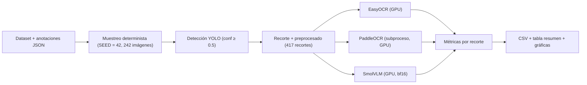
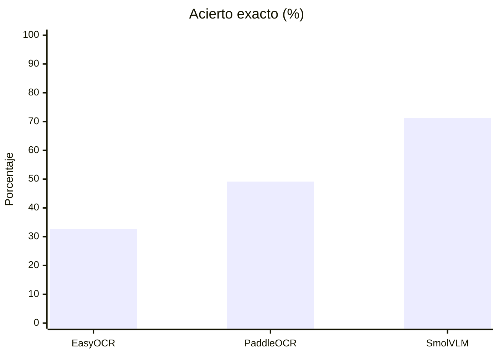
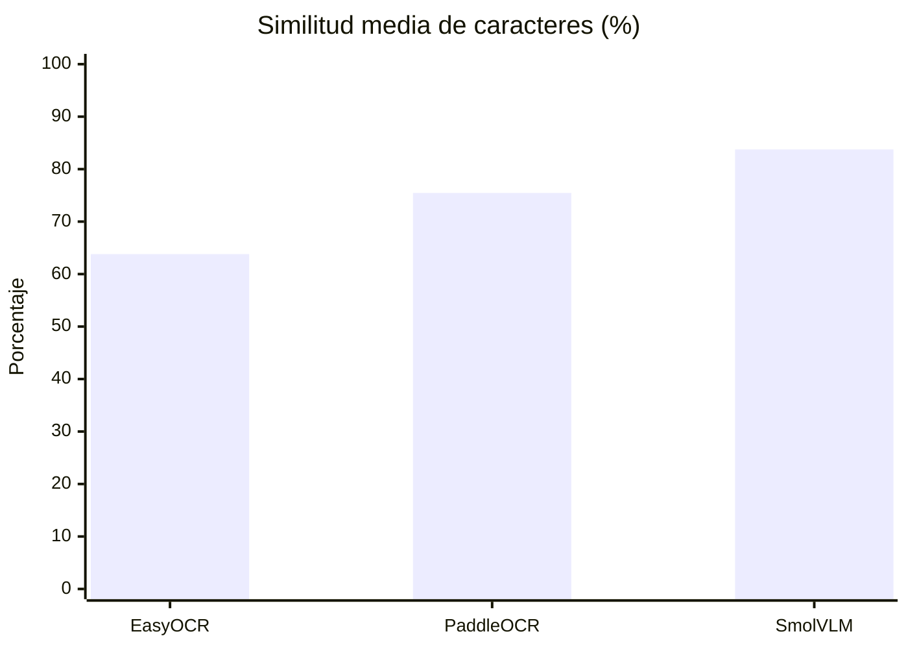
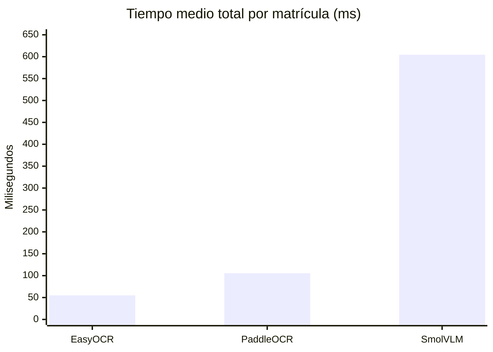
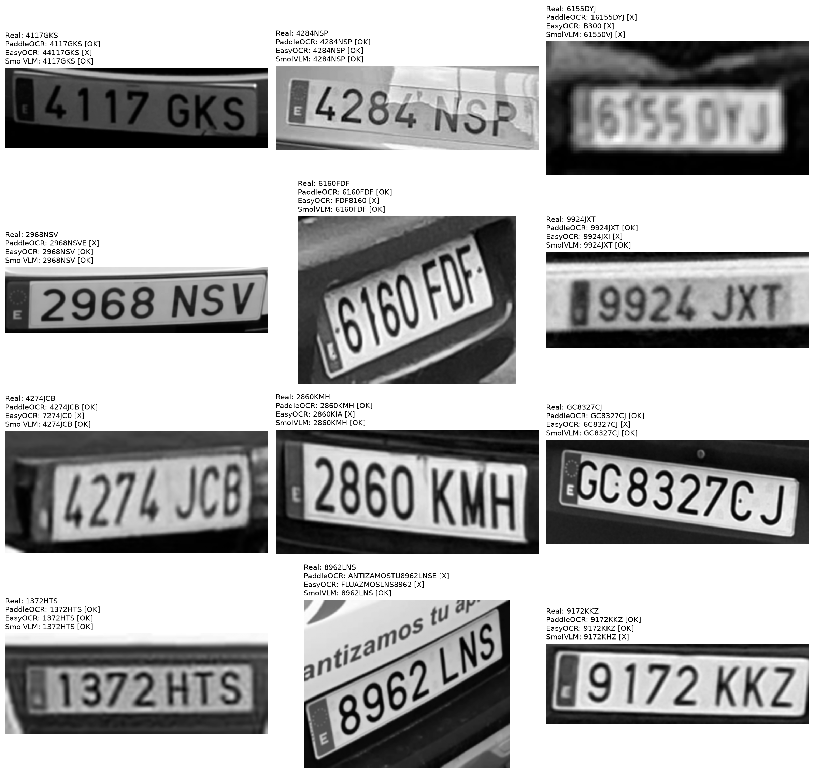

# Práctica 4b de Visión por Computador — Reconocimiento de Caracteres en Matrículas

## Datos de la práctica

- **Asignatura:** Visión por Computador
- **Práctica:** P4b (Reconocimiento de caracteres en matrículas mediante OCR y VLM)
- **Autores:** Félix Miguel Velásquez y Cristina Santana Martín
- **Cuaderno principal (vídeo + OCR):** [`VC_P4B_CSM_FMV.ipynb`](./VC_P4B_CSM_FMV.ipynb)
- **Cuaderno de comparativa (OCR vs. VLM):** [`notebooks/VC_P4B_CSM_FMV_comparative.ipynb`](./notebooks/VC_P4B_CSM_FMV_comparative.ipynb)
- **Cuaderno base de demostradores:** [`VC_P4b.ipynb`](./VC_P4b.ipynb)
- **Worker aislado de PaddleOCR:** [`paddle_ocr_worker.py`](./paddle_ocr_worker.py)
- **Resultados generados (vídeos y CSV):** [`results/`](./results/)

---

## Descripción

Esta segunda parte de la Práctica 4 amplía el sistema de detección y seguimiento desarrollado en [`P4a`](../P4a/README.md) para incorporar el **reconocimiento óptico de caracteres (OCR)** sobre las matrículas detectadas, permitiendo leer e identificar el texto de cada vehículo tanto en vídeo como en imagen estática.

El trabajo desarrollado cubre dos bloques principales:

1. **Integración de lectura de matrículas en vídeo:** Incorporación de la clase `LicensePlateOCR` al pipeline `LicensePlateVideoProcessor` (con soporte para **SmolVLM** y **EasyOCR**), mostrando el texto leído sobre el vídeo anotado y añadiendo la columna `texto_matricula` al archivo CSV fotograma a fotograma.
2. **Comparativa experimental entre OCR clásicos y VLMs:** Evaluación reproducible (`SEED = 42`) sobre los mismos recortes de matrícula detectados por YOLO comparando **EasyOCR**, **PaddleOCR** y **SmolVLM** en tasa de acierto exacto, similitud de caracteres y tiempo de inferencia.

---

## Requisitos y entorno de ejecución

Las pruebas y comparativas se han ejecutado sobre el siguiente entorno hardware y software:

- **CPU:** Intel Core i7-10700 (16 hilos)
- **RAM:** 31.25 GB
- **GPU:** NVIDIA GeForce RTX 3060 Ti (7.67 GB VRAM)
- **Entorno Python:** Python `3.11.18`, PyTorch `2.6.0+cu124`, OpenCV `4.10.0`

Las dependencias Python del proyecto se encuentran unificadas en el archivo raíz [`requirements.txt`](../requirements.txt):

```bash
pip install -r ../requirements.txt
```

Para la ejecución de los distintos motores OCR y la compresión de vídeo se deben tener en cuenta los siguientes aspectos:

- **Sistema:** `ffmpeg` para la compresión H.264 del vídeo de salida (`yolo_dual_detections_ocr_plates_compressed.mp4`). Si se utiliza `pytesseract`, requiere los binarios de [Tesseract OCR](https://tesseract-ocr.github.io/tessdoc/Installation.html) instalados y accesibles en el `PATH`.
- **OpenCV y EasyOCR:** Si al instalar `easyocr` se instala `opencv-python-headless` y dejan de funcionar ventanas de OpenCV (`cv2.imshow`), reinstalar `opencv-python`:
  ```bash
  pip uninstall -y opencv-python opencv-python-headless
  pip install opencv-python --upgrade
  ```
- **Aislamiento de PaddleOCR (`paddle_ocr_worker.py`):** PaddlePaddle y PyTorch cargan versiones incompatibles de OpenMP, oneDNN y CUDA; importarlos en el mismo kernel de Jupyter puede provocar un *segmentation fault*. Por ello, PaddleOCR se ejecuta en un subproceso independiente mediante [`paddle_ocr_worker.py`](./paddle_ocr_worker.py), comunicándose por archivos temporales JSON.

---

## 1. Integración en el pipeline de vídeo (`VC_P4B_CSM_FMV.ipynb`)

El cuaderno [`VC_P4B_CSM_FMV.ipynb`](./notebooks/VC_P4B_CSM_FMV.ipynb) parte del flujo dual de `P4a` (detector generalista COCO + detector propio de matrículas YOLOv11 + `PedestrianOcclusionManager`) y añade el módulo `LicensePlateOCR`:

- **Backends soportados:**
  - `smolvlm`: utiliza `HuggingFaceTB/SmolVLM-Instruct` con un *prompt* específico para devolver únicamente caracteres alfanuméricos de matrícula (`max_new_tokens=10`).
  - `easyocr`: utiliza `EasyOCR` con idioma `es` y lista blanca estricta `0123456789ABCDEFGHIJKLMNOPQRSTUVWXYZ`.
- **Configuración empleada en vídeo:**
  - Entrada: [`../P4a/plate_test_video.mp4`](../P4a/plate_test_video.mp4)
  - Umbral de confianza: `CONFIDENCE_THRESHOLD = 0.35`, `FRAMES_TO_CONFIRM_CLASS = 5`, `APPLY_CENSORING = True`, `COMPRESS_VIDEO = True`.
- **Salidas generadas en [`results/`](./results/):**
  - [`results/yolo_dual_detections_ocr_plates.csv`](./results/yolo_dual_detections_ocr_plates.csv): registro fotograma a fotograma que amplía las columnas de `P4a` con la columna `texto_matricula`.
  - [`results/yolo_dual_detections_ocr_plates.mp4`](./results/yolo_dual_detections_ocr_plates.mp4) y [`results/yolo_dual_detections_ocr_plates_compressed.mp4`](./results/yolo_dual_detections_ocr_plates_compressed.mp4): vídeo procesado con las detecciones, seguimiento, censura y lectura de matrícula superpuesta.

---

## 2. Comparativa OCR clásico vs. VLM (`notebooks/VC_P4B_CSM_FMV_comparative.ipynb`)

El cuaderno [`notebooks/VC_P4B_CSM_FMV_comparative.ipynb`](./notebooks/VC_P4B_CSM_FMV_comparative.ipynb) compara **EasyOCR**, **PaddleOCR** y **SmolVLM** sobre los mismos recortes de matrícula detectados por YOLO. Los resultados detallados por recorte se guardan en [`results/comparativa_resultados_parciales.csv`](./results/comparativa_resultados_parciales.csv).



### 2.1. Metodología y condiciones del experimento

- **Reproducibilidad:** Semilla global `SEED = 42` para `random`, `numpy` y `torch`, y variables de entorno (`FLAGS_use_mkldnn=0`, `KMP_DUPLICATE_LIB_OK`, `OMP_NUM_THREADS`, `MKL_NUM_THREADS`) para evitar conflictos entre librerías nativas.
- **Conjunto de evaluación:** De las **2243 imágenes válidas** (descartando anotaciones vacías, `NONE` y placeholders `0000AAA`), se eligen **242 imágenes** de forma determinista con `random.Random(SEED).sample(...)`.
- **Detección y preprocesado comunes:**
  1. Detector YOLO propio de `P4a` (`plate_detector_960_BATCH_16_small/weights/best.pt`) con `conf = 0.5` (ejecutado una sola vez, ≈ 24.3 ms de media por recorte).
  2. Recorte con margen de 5 px; si alto < 100 px o ancho < 300 px, se amplía con `INTER_CUBIC` hasta ~600 px de ancho (máximo ×3).
  3. Conversión a escala de grises y desenfoque gaussiano 5×5.
  - Resultado: **417 recortes** evaluados por cada modelo (a partir de las 242 imágenes).
- **Configuración de los modelos:**

| Modelo | Tipo | Ejecución | Configuración |
| --- | --- | --- | --- |
| **EasyOCR** | OCR neuronal (CRAFT + CRNN) | GPU, en el kernel | `lang=["es"]`, `allowlist` `0-9A-Z`; si algún fragmento tiene 7 caracteres, se usa ese |
| **PaddleOCR** | OCR neuronal (PP-OCRv6) | GPU (`--gpu`), en subproceso ([`paddle_ocr_worker.py`](./paddle_ocr_worker.py)) | `lang="es"`, modelos `PP-OCRv6_medium_det` y `PP-OCRv6_medium_rec`, sin clasificación de orientación ni corrección de perspectiva, `enable_mkldnn=False`; se unen todos los textos detectados |
| **SmolVLM** (`HuggingFaceTB/SmolVLM-Instruct`) | VLM generalista | GPU, `bfloat16` | *Prompt*: “Read the license plate text… Reply ONLY with the alphanumeric characters”, `max_new_tokens=10`, decodificación voraz |

- **Métricas registradas:** Predicción limpiada a `A-Z0-9`, **acierto exacto** carácter a carácter frente a la matrícula real más parecida de la imagen, **similitud de caracteres** (`difflib.SequenceMatcher(...).ratio()`), **tiempo OCR** (solo inferencia del lector) y **tiempo total** (YOLO + OCR). Si YOLO no detecta nada, cuenta como fallo.

### 2.2. Resultados y gráficas comparativas (417 recortes, 242 imágenes)

| Modelo | Aciertos exactos | Acierto exacto | Similitud media | Tiempo medio OCR | Tiempo medio total | Predicciones vacías |
| --- | ---: | ---: | ---: | ---: | ---: | ---: |
| **EasyOCR** | 136 / 417 | 32.61 % | 63.81 % | **30.59 ms** | **54.92 ms** | 57 |
| **PaddleOCR** | 205 / 417 | 49.16 % | 75.45 % | 81.25 ms | 105.58 ms | 46 |
| **SmolVLM** | **297 / 417** | **71.22 %** | **83.75 %** | 580.25 ms | 604.58 ms | **2** |







#### Muestras visuales de lectura por modelo



### Coincidencias entre modelos

| Situación | Recortes |
| --- | ---: |
| Los tres aciertan | 82 |
| Al menos uno acierta | 316 (75.8 %) |
| Ninguno acierta | 101 |
| Solo acierta EasyOCR | 3 |
| Solo acierta PaddleOCR | 13 |
| Solo acierta SmolVLM | 60 |

### 2.3. Conclusiones y recomendación

1. **Precisión:** **SmolVLM** lidera claramente la comparativa con un **71.22 %** de acierto exacto (297/417) y **83.75 %** de similitud media, además de registrar solo 2 predicciones vacías. **PaddleOCR** alcanza un **49.16 %** (75.45 % de similitud), mientras que **EasyOCR** se queda en un **32.61 %** (63.81 % de similitud).
2. **Velocidad:** **EasyOCR** sigue siendo el más rápido (**30.59 ms** de inferencia OCR y **54.92 ms** totales, ≈ 18 fps), seguido de **PaddleOCR** en GPU (**81.25 ms** OCR y **105.58 ms** totales, ≈ 9.5 fps), que reduce en más de 4× su tiempo respecto a CPU. **SmolVLM** es el más costoso (**580.25 ms** OCR, **604.58 ms** totales).
3. **Complementariedad:** En al menos uno de los tres modelos se acierta el **75.8 %** de los recortes (316/417), aunque SmolVLM por sí solo ya cubre la gran mayoría (60 aciertos exclusivos frente a 13 de PaddleOCR y 3 de EasyOCR).

| Escenario | Modelo recomendado |
| --- | --- |
| Vídeo en tiempo real o hardware limitado | **EasyOCR** |
| Equilibrio entre velocidad y precisión en GPU | **PaddleOCR** |
| Máxima precisión con GPU disponible | **SmolVLM** |


### 2.4. Limitaciones del experimento

- El preprocesado común (escala de grises + desenfoque) no tiene por qué ser óptimo para todos los motores.
- En el análisis de resultados, 2 de los 417 registros corresponden a imágenes donde YOLO no detectó ninguna matrícula (`recorte is None`), contando como fallo para todos los modelos.

---
