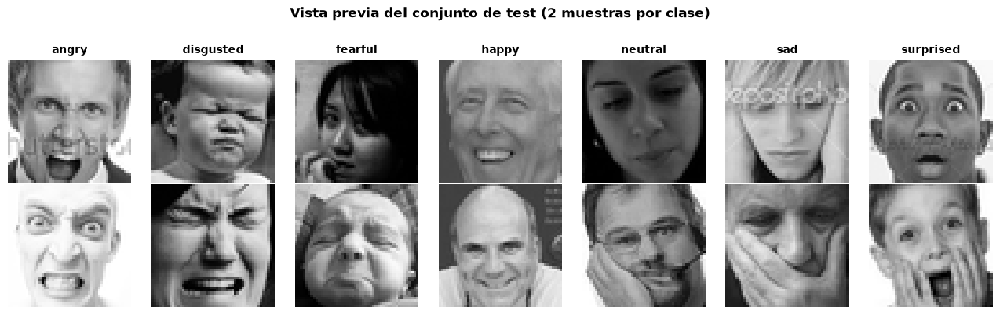
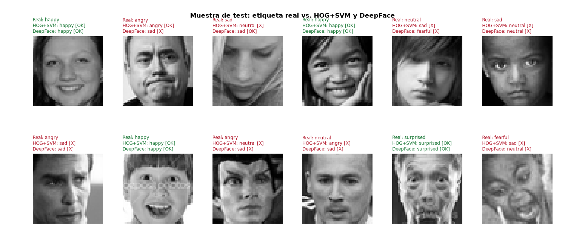
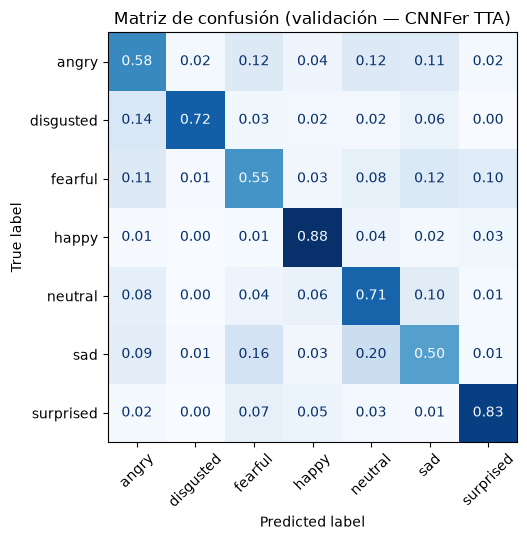
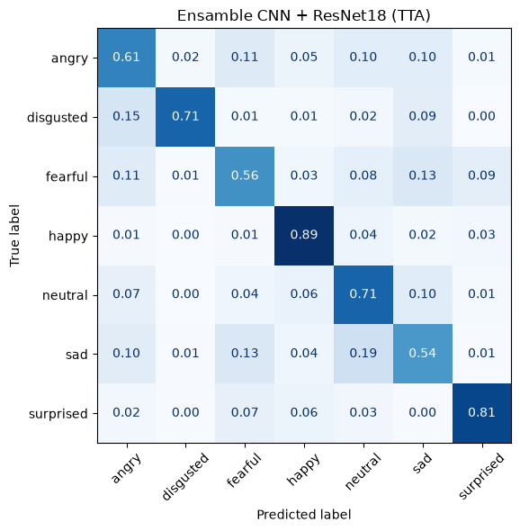
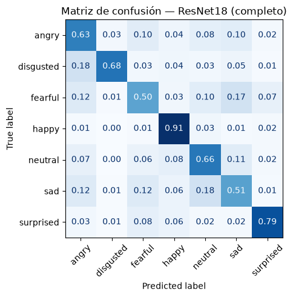

# Práctica 5 de Visión por Computador — Filtro Biométrico J.A.R.V.I.S. / Iron-Man HUD

## Datos de la práctica

- **Asignatura:** Visión por Computador
- **Práctica:** P5 — Detección biométrica y caracterización de caras (Propuesta libre)
- **Autores:** Félix Miguel Velásquez y Cristina Santana Martín
- **Cuaderno principal:** [`VC_IronMan.ipynb`](./VC_IronMan.ipynb)

---
## Tarea I - Entrenamiento de un modelo de emociones faciales con PyTorch

En esta tarea crearemos un modelo y haremos una serie de comparatifca para poder clasificar las emociones desde el dataset [FER-2013](https://www.kaggle.com/datasets/ananthu017/emotion-detection-fer). En este dataset contiene imágenes de caras **48x48 píxeles en escala de grises**, usando modelos clásicos de vision por computador hasta redes convulucionales, trasfer learning y ensables.

**Clases (7):** `angry`, `disgusted`, `fearful`, `happy`, `neutral`, `sad`, `surprised`.

## Requisitos
- Python 3.11 (entorno conda `VC_P5`).
- `numpy`, `pandas`, `matplotlib`, `opencv-python`, `scikit-learn`, `joblib`, `tqdm`.
- `torch` y `torchvision` (el entrenamiento se hizo con GPU CUDA: NVIDIA RTX 3060 Ti).
- `deepface` 

## Procedimiento general

Los notebooks forman un __pipeline__ y **debe ejecutarse en orden**, porque cada uno guarda artefactos que se utilizan para la comparativa, transfer learning y el ensamble. A continuación le ponder una tabla que resume que guarda y que hace.

| Paso | Notebook                  | Qué hace                                                | Qué guarda                     |
| ---- | ------------------------- | ------------------------------------------------------- | ------------------------------ |
| 1    | `VC_01_clasicos_deepface` | Entrena PCA/HOG/LBP + KNN/SVM/Stacked y evalúa DeepFace | `v1_otros/`                    |
| 2    | `VC_02_cnn_pytorch`       | Entrena la CNN propia `CNNFer`                          | `v1_CNN_torch/`                |
| 3    | `VC_03_transfer_learning` | Entrena ResNet-18 y EfficientNet-B0 en dos fases        | `v1_TL_*/`                     |
| 4    | `VC_04_ensemble`          | Promedia las probabilidades de CNN y ResNet-18          | `v1_ensemble_cnn_resnet18/`    |
| 5    | `VC_05_comparativa_test`  | Evalúa todo en `test/` (no entrena)                     | CSV + figuras en `outputs_p5/` |

## Decisiones de diseño comúnes a todo los notebooks.

1. **Una única semilla (`SEED = 42`)** para particiones, inicializaciones y muestreos. Así, 02, 03 y 04 usan exactamente la misma validación.
2. **Partición estratificada 80/20 de `train/`** (22.967 imágenes de entrenamiento / 5.742 de validación). La validación sirve para elegir hiperparámetros y la mejor época; **`test/` solo se usa en el notebook 05**.
3. **Métrica principal: F1-macro**, además de accuracy. FER-2013 está desbalanceado (`happy` tiene 7.215 imágenes en train y `disgusted` solo 436) y la accuracy oculta los errores en las clases minoritarias.
4. **Tratamiento del desbalance** en los modelos profundos: pesos de clase suavizados (`power=0.5`) y `label_smoothing=0.1`.
5. **TTA horizontal** (promedio de probabilidades de la imagen y su reflejo) en las evaluaciones de los modelos profundos.
6. **Muestra común de 1.000 imágenes de test** (estratificada y guardada en `deepface_test_idx.npy`) para comparar DeepFace con el resto sobre las mismas imágenes.
7. **Todo se guarda y se verifica**: cada checkpoint incluye pesos, nombres de clase y configuración de arquitectura, y los notebooks comprueban que al recargarlo se obtienen las mismas predicciones.

## Resumen de cada notebook

### 01 - Modelos clásicos y DeepFace

- **Descriptores:** píxeles + PCA (95 % de varianza → 252 componentes), HOG (900 características) y LBP (18).
- **Clasificadores:** KNN (K ∈ {5, 11, 21}) y SVM RBF (C ∈ {1, 10}), elegidos por F1-macro en validación. El SVM se entrena con un subconjunto estratificado de 10.000 imágenes; un **Stacked** (SVM por descriptor + regresión logística) con 5.000.
- **DeepFace:** solo la acción `emotion`, sin detector de caras (`"skip"`, porque las imágenes ya son caras recortadas), traduciendo sus etiquetas a las de FER-2013.
- **Idea clave:** HOG es el mejor descriptor; LBP, el peor.





### 02 - CNN propia (`CNNFer`)

- 4 bloques convolucionales (48-96-192-384 filtros) con BatchNorm, Dropout2d creciente y cabeza densa de 256 unidades.
- Aumento de datos integrado en el modelo (volteo, rotación, traslación, zoom, brillo/contraste, _random erasing_).
- `AdamW` + `ReduceLROnPlateau` + `EarlyStopping`. Mejor época: 59. Validación con TTA: **68,97 % accuracy / 67,24 % F1-macro**.




### 03 - Transfer learning

- ResNet-18 y EfficientNet-B0 preentrenadas en ImageNet.
- **Dos fases:** _warm-up_ de la cabeza (5 épocas, lr 1e-3) y _fine-tuning_ completo (hasta 35 épocas, lr 3e-4).
- Validación con TTA: ResNet-18 **68,77 % / 66,93 %**; EfficientNet-B0 68,29 % / 66,24 %. ResNet-18 es más rápida de entrenar y de inferir, y es la que pasa al ensamble.


### 04 - Ensamble
- Media simple (0,5 / 0,5) de las probabilidades de la CNN propia y de ResNet-18, ambas con TTA.
- Validación: **70,41 % accuracy / 68,71 % F1-macro**, unos +1,5 puntos de F1-macro sobre el mejor modelo individual.



### 05 - Comparativa final en test

- Carga todos los artefactos y evalúa en dos escenarios: **test completo (7.178 imágenes)** y **muestra común (1.000 imágenes)**.
- Genera las tablas, las matrices de confusión, `resultados_comparativa.csv` y `comparativa_final.png`.


## Resultado en test

**Test completo (n = 7.178)**

| Modelo                     | Accuracy | F1-macro |
| -------------------------- | -------- | -------- |
| CNN + ResNet-18 (ensamble) | 0,707    | 0,687    |
| CNN propia                 | 0,694    | 0,675    |
| ResNet-18                  | 0,685    | 0,661    |
| HOG + SVM                  | 0,510    | 0,479    |
| HOG + KNN                  | 0,497    | 0,468    |
| Stacked                    | 0,467    | 0,418    |
| PCA + SVM                  | 0,418    | 0,384    |
| LBP + KNN                  | 0,294    | 0,287    |
| PCA + KNN                  | 0,291    | 0,309    |
| LBP + SVM                  | 0,241    | 0,223    |

**Muestra común (n = 1.000), incluye DeepFace**

| Modelo                     | Accuracy | F1-macro | ms/imagen |
| -------------------------- | -------- | -------- | --------- |
| CNN propia                 | 0,707    | 0,688    | 1,64      |
| CNN + ResNet-18 (ensamble) | 0,706    | 0,685    | 4,82      |
| ResNet-18                  | 0,674    | 0,649    | 3,17      |
| DeepFace                   | 0,559    | 0,546    | 5,03      |
| HOG + KNN                  | 0,501    | 0,461    | 0,64      |
| HOG + SVM                  | 0,496    | 0,432    | 4,87      |
| Stacked                    | 0,465    | 0,420    | 3,72      |

## Gráficos de la comparativa


## Matrices de confusión en test

| CNN propia (test completo)         | ResNet-18 (test completo)                     |
| ---------------------------------- | --------------------------------------------- |
|  |  |

| Ensamble (test completo)                     | HOG + SVM (test completo)                 |
| -------------------------------------------- | ----------------------------------------- |
|  |  |

| DeepFace (muestra común)                        |
| ----------------------------------------------- |
|  |

## Conclusión
- Los modelos profundos superan a los clásicos por casi **20 puntos** de accuracy. DeepFace, sin reentrenar, queda en medio.
- En los clásicos importa más **el descriptor que el clasificador**: HOG funciona claramente mejor que PCA y LBP.
- **Transfer learning no mejora a la CNN propia** en este problema: con una receta de entrenamiento equivalente, los resultados son casi iguales. Una posible explicación (hipótesis, no comprobada en los notebooks) es que las imágenes de 48×48 en gris se parecen poco a las de ImageNet.
- El **ensamble** de dos modelos de naturaleza distinta aporta la mejora más estable en test completo, a cambio de un coste de inferencia mayor.
- Las clases más difíciles son `sad`, `fearful` y `angry`, que se confunden entre sí y con `neutral`. `happy` y `surprised` se reconocen mejor.
- En la muestra de 1.000 imágenes la diferencia entre CNN y ensamble (0,1 puntos) no es concluyente; `disgusted` solo tiene 15 imágenes en esa muestra.

## Notas y limitaciones

- **Tiempos de inferencia:** no son comparables entre test completo y muestra. En test completo, los modelos profundos van por lotes de 256; en la muestra, de imagen en imagen. Para comparar velocidades, usar la tabla de la muestra.
- **Checkpoint del ensamble:** en la ejecución del notebook 04, la verificación de recarga del `.pt` del ensamble devolvió `False` (en 02 y 03 devolvió `True`). Las métricas de 04 y 05 no dependen de ese fichero, porque el ensamble se recalcula promediando las probabilidades, pero conviene revisar su cargador antes de usarlo de forma independiente.
- **EfficientNet-B0** se entrena y se guarda en el notebook 03, pero no se incluye en la comparativa final.
- Las advertencias `FutureWarning` de `SVC(probability=True)` son esperadas con la versión de scikit-learn usada y no afectan a los resultados.
- Las rutas absolutas (`/home/cris/...`) que aparecen en las salidas guardadas son del equipo donde se ejecutó. La raíz del proyecto se detecta automáticamente buscando la carpeta `fer_lib/`.

## Tarea II - Filtro de temática libre: J.A.R.V.I.S. / Iron-Man HUD con detección de somnolencia y distracción

En este proyecto se ha desarrollado un demostrador interactivo en tiempo real inspirado en el visor holográfico J.A.R.V.I.S. (Iron-Man), proyectado directamente sobre el rostro capturado por la webcam.

El sistema parte de la detección de **landmarks faciales con MediaPipe (`FaceLandmarker`)** y combina técnicas geométricas y de visión por computador clásica con **OpenCV** para extraer telemetría biométrica continua sin necesidad de hardware especializado:

1. **Telemetría ocular (EAR):** cálculo de la relación de aspecto del ojo, conteo de parpadeos, frecuencia de parpadeo por minuto (BPM) y detección de microsueño por cierre prolongado.
2. **Telemetría oral y de fatiga (MAR):** cálculo de la relación de aspecto de la boca y detección de bostezos sostenidos.
3. **Estimación de pose 3D (`cv2.solvePnP`):** proyección 2D–3D para estimar Pitch, Yaw y Roll, radar posicional en tiempo real, calibración de postura neutra y detección de cabeceo o distracción.
4. **Malla facial táctica y retícula ocular animada:** superposición de media malla facial en *wireframe* y una retícula segmentada giratoria centrada en el iris derecho cuya velocidad reacciona al estado de alerta.
5. **Sistema reactivo de tema visual y alarma sonora:** cambio automático de la paleta del HUD (cian nominal, ámbar de advertencia y rojo crítico) acompañado de una alarma acústica asíncrona cuando se detecta fatiga o distracción.
6. **Panel integrado de telemetría emocional:** componente modular listo para consumir un modelo entrenado de emociones sobre la región facial detectada.

---

## Demostración

https://github.com/user-attachments/assets/21926703-1866-480b-aebb-c3654b42dc8a

https://github.com/user-attachments/assets/1c036da3-bf4d-479b-82bc-d51186c8b14e

---

## Requisitos y dependencias

### Entorno Python

Las dependencias del entorno se recogen en [`requirements.txt`](./requirements.txt):

```bash
pip install -r requirements.txt
```

Las bibliotecas principales empleadas por el filtro son:

- `opencv-python` / `opencv-contrib-python`
- `mediapipe`
- `numpy`
- `torch` *(para la carga del módulo de telemetría emocional integrado en el HUD)*

### Recursos adicionales

- **Modelo de MediaPipe:** [`face_landmarker.task`](./face_landmarker.task). Si no está presente en el directorio, la función `ensure_face_landmarker_model()` de [`VC_IronMan.ipynb`](./VC_IronMan.ipynb) lo descarga automáticamente desde el repositorio oficial de Google MediaPipe.
- **Audio de alarma:** [`jarvis_alarm.wav`](./jarvis_alarm.wav).
- **Cámara web:** requerida para la ejecución en vivo.

---

## Arquitectura del proyecto

El proyecto que reside en [`ironmanhudv2/`](./ironmanhudv2/) está organizado en módulos y clases que encapsulan la funcionalidad del HUD:
- `FrameCanvas`: maneja la visualización y manipulación del lienzo de la imagen.
- `IronManHUDRenderer`: se encarga de renderizar el HUD en la imagen.
- `FaceLandmarker`: detecta y procesa los puntos de referencia faciales.
- `BiometricTracker`: realiza el seguimiento biometrico del usuario.
- `FacialMeshHUD`: dibuja la malla facial y la retícula ocular.
- `AudioAlarm`: gestiona la reproducción de la alarma sonora.
- `EmotionTelemetryPanel`: integra la telemetría emocional en el HUD.
- `TimeSeriesTelemetryHUD`: dibuja las gráficas de telemetría temporal (EAR, MAR, pose 3D).

---

## Funcionamiento del filtro

### 1. Detección facial y normalización del lienzo

En cada fotograma, `FrameCanvas` invierte horizontalmente la imagen para ofrecer una interacción tipo espejo natural. A continuación, `IronManHUDRenderer` convierte el fotograma de BGR a RGB y ejecuta `FaceLandmarker` en modo `RunningMode.VIDEO` (`num_faces=1`, `output_face_blendshapes=True`).

A partir de los landmarks normalizados devueltos por MediaPipe, `BiometricTracker.extract_landmarks_2d()` los proyecta al espacio de píxeles del lienzo (`pts_2d`) y calcula la caja delimitadora del rostro mediante `compute_bbox()`.

### 2. Telemetría ocular (`EAR`, parpadeos y microsueño)

La apertura ocular se cuantifica mediante el **Eye Aspect Ratio (EAR)** calculado independientemente para ambos ojos (`LEFT_EYE_IDXS` y `RIGHT_EYE_IDXS`):

$$\text{EAR} = \frac{\|p_2 - p_6\| + \|p_3 - p_5\|}{2 \cdot \|p_1 - p_4\|}$$

- **Suavizado:** se promedia el EAR izquierdo y derecho y se filtra mediante una media móvil exponencial (`exp_moving_avg`, configurada en el cuaderno con `alpha = 0.2`).
- **Conteo de parpadeos y BPM:** cuando el EAR bruto cae por debajo de `threshold = 0.21` durante al menos `consec_frames_blink = 2` fotogramas consecutivos y el ojo vuelve a abrirse, se registra un parpadeo y se calcula la frecuencia en parpadeos por minuto (BPM) usando una ventana deslizante de 60 segundos.
- **Detección de microsueño:** si el cierre ocular se mantiene de forma continua durante `micro_sleep_seconds = 1.2 s` o más, se activa el estado `micro_sleep`.
- **Visualización:** el panel `OCULAR TELEMETRY` muestra el valor actual, una barra con indicador de umbral, una gráfica temporal de los últimos 75 fotogramas, el total de parpadeos, los BPM y el temporizador de cierre ocular.

### 3. Telemetría oral y de fatiga (`MAR` y bostezos)

La apertura de la boca se mide mediante el **Mouth Aspect Ratio (MAR)** utilizando las comisuras `(61, 291)` y tres pares verticales de labios `(81, 178)`, `(13, 14)` y `(311, 402)`:

$$\text{MAR} = \frac{\frac{1}{3}\sum_{k=1}^{3}\|a_k - b_k\|}{\|c_{\text{izq}} - c_{\text{der}}\|}$$

- **Suavizado:** el valor bruto se suaviza mediante EMA (`alpha = 0.45`).
- **Detección de bostezo:** si el MAR suavizado supera `threshold = 0.55` durante al menos `yawn_seconds = 1.0 s`, se activa la bandera `yawning` y se incrementa `yawn_count` una sola vez por evento hasta que la boca vuelve a cerrarse.
- **Visualización:** el panel `ORAL / FATIGUE TELEMETRY` presenta el valor MAR, barra de umbral, gráfica histórica y contador de bostezos.

### 4. Estimación de pose 3D y calibración (`cv2.solvePnP`)

Para estimar la orientación tridimensional de la cabeza se corresponden 6 landmarks faciales clave (`PNP_LANDMARK_IDXS`: punta de la nariz `1`, mentón `152`, comisuras oculares externas `263, 33` y comisuras labiales `291, 61`) con sus homólogos en el modelo 3D genérico `MODEL_3D_POINTS`.

1. `solve_head_pose_pnp()` construye una matriz intrínseca aproximada (`focal = width`, centro óptico en `(width/2, height/2)` y distorsión nula) y resuelve la pose con `cv2.solvePnP` (`SOLVEPNP_ITERATIVE`, con respaldo `SOLVEPNP_EPNP` si la solución queda detrás de la cámara).
2. A partir de `cv2.Rodrigues`, `rotation_matrix_to_euler()` extrae los ángulos Pitch, Yaw y Roll en grados.
3. **Calibración neutra:** al pulsar la tecla `c`, `register_calibration()` fija la postura actual como referencia cero (`_pose_offset`) y normaliza los ángulos relativos al rango `[-180°, 180°]` antes de suavizarlos con EMA (`alpha = 0.4`).
4. **Alertas de atención:** tras mantenerse la desviación durante `pose_alert_seconds = 1.0 s`:
   - **Cabeceo (`nodding_off`):** `pitch <= -18.0°`
   - **Distracción (`looking_away`):** `|yaw| >= 28.0°` o `pitch >= 25.0°`
5. **Radar 3D:** el panel `3D HEAD POSE TELEMETRY` muestra los ángulos numéricos, el estado de calibración y un radar circular donde el punto se desplaza según `Yaw` (eje horizontal) y `Pitch` (eje vertical).

Todos estos parametros son configurables en el cuaderno principal [`VC_IronMan.ipynb`](./VC_IronMan.ipynb) mediante la variable `BIOMETRY_CONFIG`.

### 5. Malla táctica y retícula ocular (`FacialMeshHUD`)

Sobre el rostro detectado se dibujan dos elementos holográficos inspirados en el visor de Iron-Man:

- **Retícula ocular animada:** situada sobre el iris derecho (`RIGHT_IRIS_IDX = 468`), compuesta por cinco anillos/arcos concéntricos que giran en sentidos opuestos (`95°/s` en estado normal y multiplicado por `2.5` ante `micro_sleep` o `looking_away`). Su radio se adapta automáticamente a la distancia a la cámara combinando altura facial, distancia interocular y anchura del ojo.
- **Malla facial de media cara:** *wireframe* sobre el hemisferio izquierdo del rostro (`37` nodos y conexiones predefinidas en `LEFT_HALF_FACE_MESH_IDXS` y `LEFT_HALF_FACE_MESH_CONNECTIONS`), manteniendo abiertas las regiones internas del ojo y la boca para no tapar la mirada ni entorpecer la lectura del HUD.

### 6. Sistema reactivo de colores y alarma acústica

`resolve_hud_theme()` selecciona el tema completo del HUD (paneles, esquinas, retícula, malla, barras, gráficas y radar) en función del estado biométrico actual:

- **Nominal (`DEFAULT_HUD_THEME`):** tonos cian/azul con indicadores en verde.
- **Advertencia (`WARNING_HUD_THEME`):** tonos ámbar/naranja cuando se detecta distracción (`looking_away`) o bostezo (`yawning`).
- **Crítico (`CRITICAL_HUD_THEME`):** tonos rojo carmesí cuando se detecta `micro_sleep`.

De forma paralela, `_trigger_audio_alarm()` dispara `AudioAlarm.trigger()` con [`jarvis_alarm.wav`](./jarvis_alarm.wav) y un *cooldown* de `1.8 s` siempre que esté activa alguna de las condiciones de `micro_sleep`, `looking_away` o `yawning`.

---

## Ejecución y controles

### Lanzamiento desde el cuaderno

1. Abrir [`VC_IronMan.ipynb`](./VC_IronMan.ipynb) dentro de la carpeta `P5/`.
2. Ejecutar las celdas en orden para configurar la cámara (`1280x720`, V4L2/MJPG en Linux, DSHOW en Windows), descargar `face_landmarker.task` si hace falta y lanzar `run_ironman_hud()`.

### Controles en vivo

| Tecla | Acción |
| :--- | :--- |
| `c` / `C` | Calibrar la pose neutra actual de la cabeza como referencia `0°` en Pitch, Yaw y Roll |
| `q` / `Q` / `ESC` | Detener la captura, liberar la cámara y cerrar la ventana del HUD |

---

## Limitaciones y posibles mejoras

- **Seguimiento monousuario:** `FaceLandmarker` está configurado con `num_faces=1`, por lo que en escenas con varias personas solo se procesa el rostro principal detectado.
- **Matriz de cámara aproximada:** `build_camera_matrix()` asume `focal = width` y distorsión cero; tras pulsar `c` los ángulos relativos son consistentes, pero la precisión absoluta depende de la cámara sin calibración intrínseca previa.
- **Umbrales fijos de EAR y MAR:** los umbrales (`0.21` y `0.55`) funcionan bien de forma general, aunque podrían calibrarse automáticamente por usuario durante los primeros segundos (al igual que la pose 3D).

---

## Referencias

- [MediaPipe Face Landmarker — Google AI Edge](https://ai.google.dev/edge/mediapipe/solutions/vision/face_landmarker)
- [OpenCV `solvePnP` y estimación de pose](https://docs.opencv.org/4.x/d5/d1f/calib3d_solvePnP.html)
- Soukupová, T., & Čech, J. (2016). *Real-Time Eye Blink Detection using Facial Landmarks*. 21st Computer Vision Winter Workshop.
- [FER-2013 dataset de las emociones](https://www.kaggle.com/datasets/ananthu017/emotion-detection-fer)
