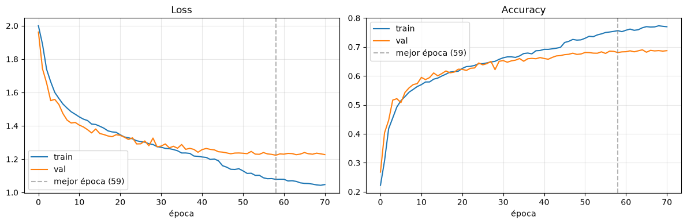
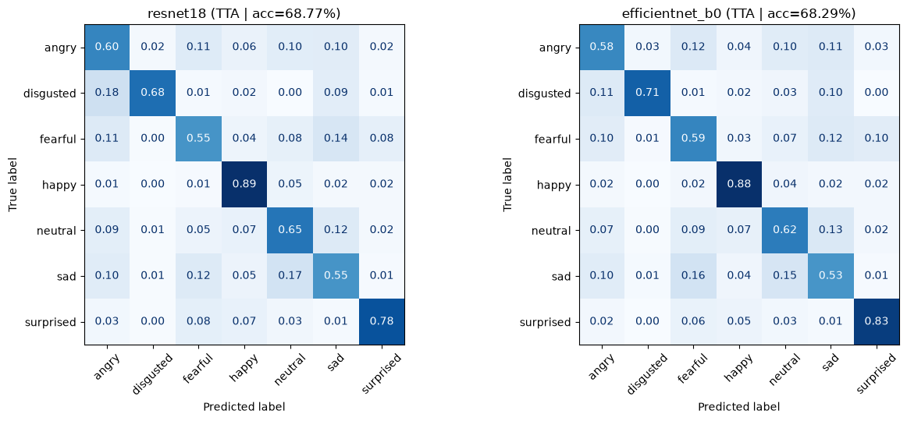
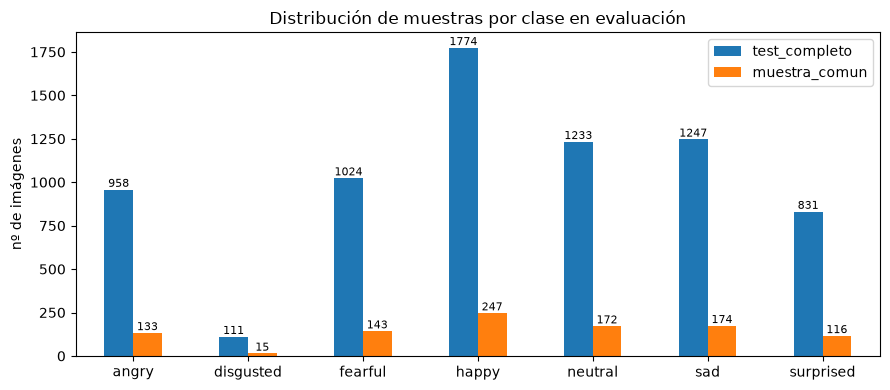
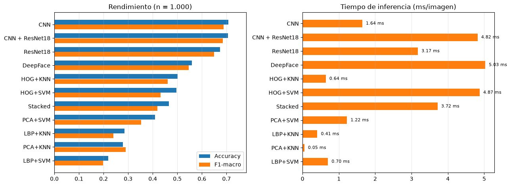
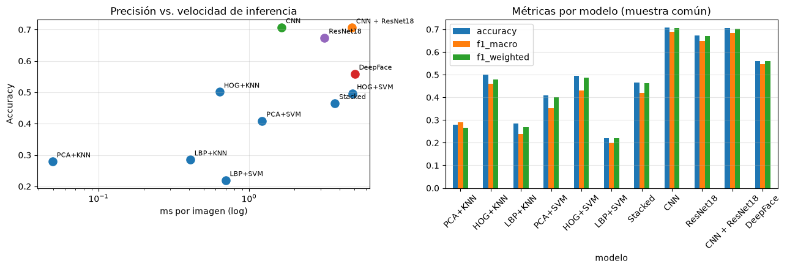
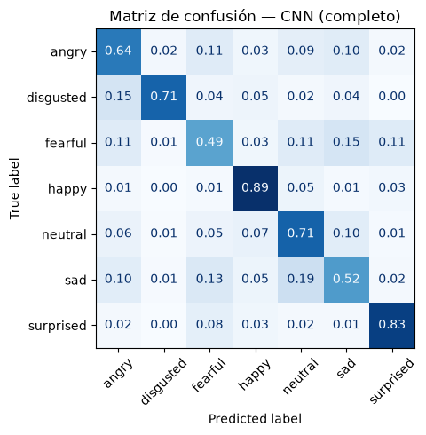
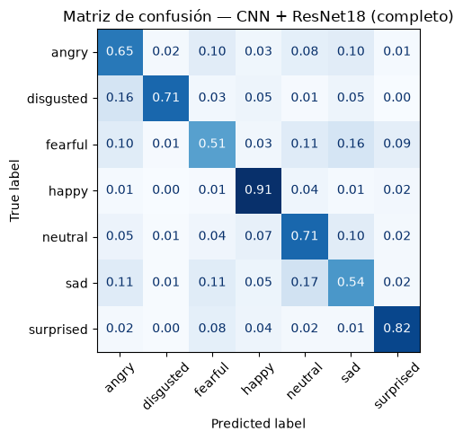
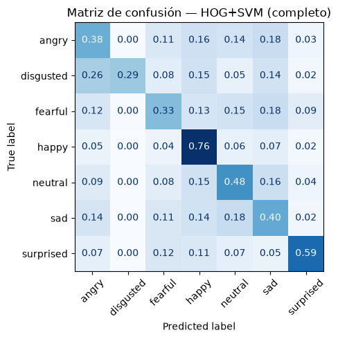
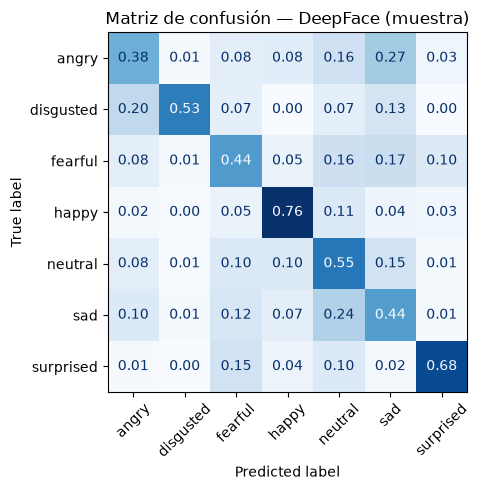

# Práctica 5 de Visión por Computador — Filtro Biométrico J.A.R.V.I.S. / Iron-Man HUD

## Datos de la práctica

- **Asignatura:** Visión por Computador
- **Práctica:** P5 — Detección biométrica y caracterización de caras (Propuesta libre)
- **Autores:** Félix Miguel Velásquez y Cristina Santana Martín
- **Cuaderno principal:** [`VC_IronMan.ipynb`](./VC_IronMan.ipynb)

---
## Requisitos y dependencias

### Entorno Python

Las dependencias del entorno se recogen en [`requirements.txt`](./requirements.txt):

```bash
pip install -r requirements.txt
```

Las bibliotecas principales empleadas por el filtro son:

- `opencv-python` / `opencv-contrib-python`
- `mediapipe`
- `numpy`
- `torch` _(para la carga del módulo de telemetría emocional integrado en el HUD)_

Las bibliotecas principales para la comparativa:
- `torch` y `torchvision` (el entrenamiento se hizo con GPU CUDA: NVIDIA RTX 3060 Ti).
- `deepface`
---

## Tarea I - Entrenamiento de un modelo de emociones faciales con PyTorch

En esta tarea crearemos un modelo y haremos una serie de comparatifca para poder clasificar las emociones desde el dataset [FER-2013](https://www.kaggle.com/datasets/ananthu017/emotion-detection-fer). En este dataset contiene imágenes de caras **48x48 píxeles en escala de grises**, usando modelos clásicos de vision por computador hasta redes convulucionales, trasfer learning y ensables.

**Clases (7):** `angry`, `disgusted`, `fearful`, `happy`, `neutral`, `sad`, `surprised`.

## Demostración

https://github.com/user-attachments/assets/21926703-1866-480b-aebb-c3654b42dc8a

## Requisitos

- Python 3.11 (entorno conda `VC_P5`).
- `numpy`, `pandas`, `matplotlib`, `opencv-python`, `scikit-learn`, `joblib`, `tqdm`.


## Procedimiento general

Los notebooks forman un **pipeline** y **debe ejecutarse en orden**, porque cada uno guarda artefactos que se utilizan para la comparativa, transfer learning y el ensamble. A continuación le ponder una tabla que resume que guarda y que hace.

| Paso | Notebook                  | Qué hace                                                | Qué guarda                     |
| ---- | ------------------------- | ------------------------------------------------------- | ------------------------------ |
| 1    | `VC_01_clasicos_deepface` | Entrena PCA/HOG/LBP + KNN/SVM/Stacked y evalúa DeepFace | `v1_otros/`                    |
| 2    | `VC_02_cnn_pytorch`       | Entrena la CNN propia `CNNFer`                          | `v1_CNN_torch/`                |
| 3    | `VC_03_transfer_learning` | Entrena ResNet-18 y EfficientNet-B0 en dos fases        | `v1_TL_*/`                     |
| 4    | `VC_04_ensemble`          | Promedia las probabilidades de CNN y ResNet-18          | `v1_ensemble_cnn_resnet18/`    |
| 5    | `VC_05_comparativa_test`  | Evalúa todo en `test/` (no entrena)                     | CSV + figuras en `outputs_p5/` |

## Decisiones de diseño comúnes a todo los notebooks.

1. **Una única semilla (`SEED = 42`)** para particiones, inicializaciones y muestreos. Así, 02, 03 y 04 usan exactamente la misma validación.
2. **Partición estratificada 80/20 de `train/`** (22.967 imágenes de entrenamiento / 5.742 de validación). La validación sirve para elegir hiperparámetros y la mejor época; **`test/` solo se usa en el notebook 05**.
3. **Métrica principal: F1-macro**, además de accuracy. FER-2013 está desbalanceado (`happy` tiene 7.215 imágenes en train y `disgusted` solo 436) y la accuracy oculta los errores en las clases minoritarias.
4. **Tratamiento del desbalance** en los modelos profundos: pesos de clase suavizados (`power=0.5`) y `label_smoothing=0.1`.
5. **TTA horizontal** (promedio de probabilidades de la imagen y su reflejo) en las evaluaciones de los modelos profundos.
6. **Muestra común de 1.000 imágenes de test** (estratificada y guardada en `deepface_test_idx.npy`) para comparar DeepFace con el resto sobre las mismas imágenes.
7. **Todo se guarda y se verifica**: cada checkpoint incluye pesos, nombres de clase y configuración de arquitectura, y los notebooks comprueban que al recargarlo se obtienen las mismas predicciones.

## Resumen de cada notebook

### 01 - Modelos clásicos y DeepFace

- **Descriptores:** píxeles + PCA (95 % de varianza → 252 componentes), HOG (900 características) y LBP (18).
- **Clasificadores:** KNN (K ∈ {5, 11, 21}) y SVM RBF (C ∈ {1, 10}), elegidos por F1-macro en validación. El SVM se entrena con un subconjunto estratificado de 10.000 imágenes; un **Stacked** (SVM por descriptor + regresión logística) con 5.000.
- **DeepFace:** solo la acción `emotion`, sin detector de caras (`"skip"`, porque las imágenes ya son caras recortadas), traduciendo sus etiquetas a las de FER-2013.
- **Idea clave:** HOG es el mejor descriptor; LBP, el peor.


### 02 - CNN propia (`CNNFer`)

- 4 bloques convolucionales (48-96-192-384 filtros) con BatchNorm, Dropout2d creciente y cabeza densa de 256 unidades.
- Aumento de datos integrado en el modelo (volteo, rotación, traslación, zoom, brillo/contraste, _random erasing_).
- `AdamW` + `ReduceLROnPlateau` + `EarlyStopping`. Mejor época: 59. Validación con TTA: **68,97 % accuracy / 67,24 % F1-macro**.




### 03 - Transfer learning

- ResNet-18 y EfficientNet-B0 preentrenadas en ImageNet.
- **Dos fases:** _warm-up_ de la cabeza (5 épocas, lr 1e-3) y _fine-tuning_ completo (hasta 35 épocas, lr 3e-4).
- Validación con TTA: ResNet-18 **68,77 % / 66,93 %**; EfficientNet-B0 68,29 % / 66,24 %. ResNet-18 es más rápida de entrenar y de inferir, y es la que pasa al ensamble.



### 04 - Ensamble

- Media simple (0,5 / 0,5) de las probabilidades de la CNN propia y de ResNet-18, ambas con TTA.
- Validación: **70,41 % accuracy / 68,71 % F1-macro**, unos +1,5 puntos de F1-macro sobre el mejor modelo individual.


### 05 - Comparativa final en test

- Carga todos los artefactos y evalúa en dos escenarios: **test completo (7.178 imágenes)** y **muestra común (1.000 imágenes)**.
- Genera las tablas, las matrices de confusión, `resultados_comparativa.csv` y `comparativa_final.png`.



## Resultado en test

**Test completo (n = 7.178)**

| Modelo                     | Accuracy | F1-macro |
| -------------------------- | -------- | -------- |
| CNN + ResNet-18 (ensamble) | 0,707    | 0,687    |
| CNN propia                 | 0,694    | 0,675    |
| ResNet-18                  | 0,685    | 0,661    |
| HOG + SVM                  | 0,510    | 0,479    |
| HOG + KNN                  | 0,497    | 0,468    |
| Stacked                    | 0,467    | 0,418    |
| PCA + SVM                  | 0,418    | 0,384    |
| LBP + KNN                  | 0,294    | 0,287    |
| PCA + KNN                  | 0,291    | 0,309    |
| LBP + SVM                  | 0,241    | 0,223    |

**Muestra común (n = 1.000), incluye DeepFace**

| Modelo                     | Accuracy | F1-macro | ms/imagen |
| -------------------------- | -------- | -------- | --------- |
| CNN propia                 | 0,707    | 0,688    | 1,64      |
| CNN + ResNet-18 (ensamble) | 0,706    | 0,685    | 4,82      |
| ResNet-18                  | 0,674    | 0,649    | 3,17      |
| DeepFace                   | 0,559    | 0,546    | 5,03      |
| HOG + KNN                  | 0,501    | 0,461    | 0,64      |
| HOG + SVM                  | 0,496    | 0,432    | 4,87      |
| Stacked                    | 0,465    | 0,420    | 3,72      |


## Gráficos de la comparativa





## Matrices de confusión en test

| CNN propia (test completo)         | ResNet-18 (test completo)                     |
| ---------------------------------- | --------------------------------------------- |
|  |  |

| Ensamble (test completo)                     | HOG + SVM (test completo)                 |
| -------------------------------------------- | ----------------------------------------- |
|  |  |

| DeepFace (muestra común)                        |
| ----------------------------------------------- |
|  |
### Rendimiento por emoción
 
Para cada emoción se muestran precisión, recall y F1 en el **test completo** (7.178 imágenes) y en la **muestra común** (1.000 imágenes). En negrita, el mejor valor de cada columna. DeepFace solo se evaluó en la muestra, y de los clásicos el informe por clase solo se imprime para HOG+SVM en el test completo. «—» indica que ese modelo no se evaluó en ese conjunto o que su informe por clase no se generó.
 
#### `angry` (test: 958 imágenes · muestra: 133)
 
| Modelo | Precisión (test) | Recall (test) | F1 (test) | Precisión (muestra) | Recall (muestra) | F1 (muestra) |
|---|---|---|---|---|---|---|
| HOG+SVM | 0,386 | 0,381 | 0,383 | — | — | — |
| CNN propia | 0,631 | 0,637 | 0,634 | **0,639** | 0,639 | 0,639 |
| ResNet-18 | 0,589 | 0,633 | 0,610 | 0,545 | 0,632 | 0,585 |
| Ensamble | **0,635** | **0,652** | **0,643** | 0,631 | **0,669** | **0,650** |
| DeepFace | — | — | — | 0,500 | 0,376 | 0,429 |
 
El ensamble es el mejor en ambos escenarios, seguido de la CNN. HOG+SVM y DeepFace quedan muy por debajo; DeepFace tiene un recall de solo 0,376: se deja sin detectar casi dos de cada tres.
 
#### `disgusted` (test: 111 imágenes · muestra: 15)
 
| Modelo | Precisión (test) | Recall (test) | F1 (test) | Precisión (muestra) | Recall (muestra) | F1 (muestra) |
|---|---|---|---|---|---|---|
| HOG+SVM | **0,711** | 0,288 | 0,410 | — | — | — |
| CNN propia | 0,627 | **0,712** | 0,667 | **0,667** | **0,667** | **0,667** |
| ResNet-18 | 0,581 | 0,676 | 0,625 | **0,667** | 0,533 | 0,593 |
| Ensamble | 0,632 | **0,712** | **0,669** | 0,625 | **0,667** | 0,645 |
| DeepFace | — | — | — | 0,571 | 0,533 | 0,552 |
 
Ensamble y CNN prácticamente empatan en test. HOG+SVM tiene la mayor precisión (0,711) pero un recall de 0,288: acierta cuando predice `disgusted`, pero se deja la mayoría sin detectar. En la muestra solo hay 15 imágenes, así que esas cifras son poco fiables.
 
#### `fearful` (test: 1024 imágenes · muestra: 143)
 
| Modelo | Precisión (test) | Recall (test) | F1 (test) | Precisión (muestra) | Recall (muestra) | F1 (muestra) |
|---|---|---|---|---|---|---|
| HOG+SVM | 0,391 | 0,332 | 0,359 | — | — | — |
| CNN propia | 0,550 | 0,486 | 0,516 | **0,634** | 0,497 | 0,557 |
| ResNet-18 | 0,561 | 0,497 | 0,527 | 0,612 | 0,517 | 0,561 |
| Ensamble | **0,589** | **0,509** | **0,546** | 0,623 | **0,531** | **0,574** |
| DeepFace | — | — | — | 0,444 | 0,441 | 0,442 |
 
Es una de las más difíciles para todos: el recall de los modelos profundos ronda el 0,5, es decir, se pierde aproximadamente la mitad de los casos. El ensamble mejora más aquí que en otras clases (+1,9 puntos sobre ResNet-18, el mejor individual).
 
#### `happy` (test: 1774 imágenes · muestra: 247)
 
| Modelo | Precisión (test) | Recall (test) | F1 (test) | Precisión (muestra) | Recall (muestra) | F1 (muestra) |
|---|---|---|---|---|---|---|
| HOG+SVM | 0,642 | 0,762 | 0,697 | — | — | — |
| CNN propia | **0,871** | 0,888 | 0,879 | **0,898** | 0,858 | 0,878 |
| ResNet-18 | 0,848 | **0,911** | 0,878 | 0,855 | **0,883** | 0,869 |
| Ensamble | 0,864 | 0,905 | **0,884** | 0,889 | 0,879 | **0,884** |
| DeepFace | — | — | — | 0,777 | 0,761 | 0,769 |
 
La mejor reconocida por todos los modelos: los tres profundos están en torno a 0,88 de F1 y la diferencia entre ellos es mínima. Incluso DeepFace alcanza 0,77.
 
#### `neutral` (test: 1233 imágenes · muestra: 172)
 
| Modelo | Precisión (test) | Recall (test) | F1 (test) | Precisión (muestra) | Recall (muestra) | F1 (muestra) |
|---|---|---|---|---|---|---|
| HOG+SVM | 0,466 | 0,476 | 0,471 | — | — | — |
| CNN propia | 0,625 | **0,715** | 0,667 | 0,604 | **0,727** | **0,660** |
| ResNet-18 | 0,627 | 0,662 | 0,644 | 0,588 | 0,640 | 0,613 |
| Ensamble | **0,642** | 0,713 | **0,676** | **0,611** | 0,703 | 0,654 |
| DeepFace | — | — | — | 0,432 | 0,552 | 0,485 |
 
El ensamble gana en test y la CNN en la muestra, con diferencias pequeñas. En la CNN y el ensamble el recall (≈ 0,71) es mayor que la precisión (≈ 0,63): tienden a predecir `neutral` más de la cuenta. DeepFace muestra el mismo sesgo con más intensidad (recall 0,552 frente a precisión 0,432).
 
#### `sad` (test: 1247 imágenes · muestra: 174)
 
| Modelo | Precisión (test) | Recall (test) | F1 (test) | Precisión (muestra) | Recall (muestra) | F1 (muestra) |
|---|---|---|---|---|---|---|
| HOG+SVM | 0,400 | 0,398 | 0,399 | — | — | — |
| CNN propia | 0,611 | 0,518 | 0,561 | **0,635** | **0,580** | **0,607** |
| ResNet-18 | 0,588 | 0,508 | 0,545 | 0,580 | 0,500 | 0,537 |
| Ensamble | **0,620** | **0,544** | **0,579** | 0,625 | 0,546 | 0,583 |
| DeepFace | — | — | — | 0,437 | 0,437 | 0,437 |
 
Junto con `fearful`, la más difícil de los modelos profundos: el recall queda en 0,51–0,54. El ensamble es el mejor en test y la CNN en la muestra.
 
#### `surprised` (test: 831 imágenes · muestra: 116)
 
| Modelo | Precisión (test) | Recall (test) | F1 (test) | Precisión (muestra) | Recall (muestra) | F1 (muestra) |
|---|---|---|---|---|---|---|
| HOG+SVM | 0,690 | 0,591 | 0,636 | — | — | — |
| CNN propia | 0,766 | **0,834** | 0,798 | 0,746 | **0,888** | **0,811** |
| ResNet-18 | **0,796** | 0,794 | 0,795 | 0,769 | 0,802 | 0,785 |
| Ensamble | 0,795 | 0,824 | **0,809** | **0,772** | 0,845 | 0,807 |
| DeepFace | — | — | — | 0,731 | 0,681 | 0,705 |
 
La segunda mejor reconocida. Los tres modelos profundos están a menos de 1,5 puntos entre sí; el ensamble gana en test y la CNN en la muestra.
 
#### Resumen: mejor modelo por emoción
 
| Emoción | Mejor en test completo (F1) | Mejor en muestra común (F1) |
|---|---|---|
| `angry` | Ensamble (0,643) | Ensamble (0,650) |
| `disgusted` | Ensamble (0,669) | CNN propia (0,667) |
| `fearful` | Ensamble (0,546) | Ensamble (0,574) |
| `happy` | Ensamble (0,884) | Ensamble (0,884) |
| `neutral` | Ensamble (0,676) | CNN propia (0,660) |
| `sad` | Ensamble (0,579) | CNN propia (0,607) |
| `surprised` | Ensamble (0,809) | CNN propia (0,811) |
 
- **El ensamble es el mejor en las 7 emociones en test completo**, pero la ventaja sobre el mejor modelo individual es pequeña: entre 0,2 y 1,9 puntos de F1.
- En la muestra común la CNN propia gana en `disgusted`, `neutral`, `sad` y `surprised`. Con solo 1.000 imágenes (y 15 de `disgusted`) esas diferencias no son concluyentes.
- El orden de dificultad es parecido en todos los modelos: `happy` y `surprised` se reconocen mejor; `fearful`, `sad` y `angry` peor.
- Los modelos profundos superan a HOG+SVM en las 7 emociones, con una diferencia de entre 17 y 26 puntos de F1 (la menor en `surprised`, la mayor en `angry`).
---
##  ¿Por qué se usa TTA?
 
**TTA** (*Test-Time Augmentation*) consiste en hacer la predicción sobre varias versiones de la misma imagen y promediar los resultados. Aquí se usa la versión más simple: la imagen original y su **reflejo horizontal**, y se promedian las probabilidades de ambas.
 
```
p_final = ½ · p(imagen) + ½ · p(imagen volteada)
```
 
### Motivos
 
1. **Una cara volteada sigue expresando la misma emoción.** El volteo horizontal no cambia la etiqueta, y es una transformación segura, a diferencia de otras que podrían alterar la expresión.
2. **Es coherente con el entrenamiento.** Tanto la CNN propia como los modelos de transfer learning se entrenan con volteo horizontal aleatorio (p = 0,5) como parte del aumento de datos. En test, el modelo ya ha visto caras en ambas orientaciones, así que el reflejo no le resulta una entrada extraña.
3. **Reduce la varianza de la predicción.** Promediar dos "vistas" de la misma cara suaviza errores puntuales. Es el mismo principio que el del ensamble (notebook 04), pero con un único modelo.

### Qué mejora (medido en validación, notebook 03)
 
| Modelo | Accuracy sin TTA | Accuracy con TTA | F1-macro sin TTA | F1-macro con TTA |
|---|---|---|---|---|
| ResNet-18 | 68,18 % | 68,77 % | 66,41 % | 66,93 % |
| EfficientNet-B0 | 67,97 % | 68,29 % | 66,01 % | 66,24 % |
 
La mejora es **pequeña pero consistente**: entre +0,3 y +0,6 puntos de accuracy y entre +0,2 y +0,5 de F1-macro en ambos modelos.
 
### Qué cuesta
 
- La inferencia necesita **dos pasadas** por la red en lugar de una, por lo que el tiempo por imagen se multiplica aproximadamente por dos. Por eso los ms/imagen de las tablas de este README son con TTA.
- En una aplicación con restricciones de tiempo real, sería razonable desactivarlo y asumir la pérdida de medio punto.
### Cómo aplicarlo en la comparativa
 
- Se aplica a **todos los modelos profundos** (CNN, ResNet-18, EfficientNet-B0 y el ensamble) en validación y test, para que se comparen en igualdad de condiciones entre ellos.
- **No se aplica** a los modelos clásicos ni a DeepFace, que se usan tal cual. Conviene tenerlo en cuenta al leer la comparativa: parte de la ventaja de los modelos profundos (en torno a medio punto) viene del TTA, aunque es muy pequeña frente a la diferencia de casi 20 puntos con los clásicos.
- Solo el notebook 03 mide el efecto con y sin TTA; en los notebooks 02, 04 y 05 los resultados se dan directamente con TTA.

---
## Conclusión


**Reconocimiento en tiempo real: ensamble frente a CNN propia.** En la muestra común, la CNN y el ensamble rinden prácticamente igual (70,7 % frente a 70,6 % de accuracy), pero el ensamble necesita unos 4,8 ms por imagen frente a 1,6 ms de la CNN, casi el triple, porque ejecuta además ResNet-18 y aplica TTA en ambos modelos. 

Con la misma precisión y mucho más coste, la CNN es la opción más adecuada para tiempo real. Además, al probarlo en el filtro en vivo, el ensamble representó peor las emociones que la CNN sola. Una posible explicación es que ResNet-18, que de forma individual es menos precisa que la CNN (67,4 % frente a 70,7 % en la muestra), arrastra hacia abajo al ensamble cuando la entrada se aleja de FER-2013. La cámara da imágenes en color, con otra resolución, iluminación y encuadre, mientras que el dataset son caras de 48×48 en gris.

### Datos a tener en cuenta
- Los modelos profundos superan a los clásicos por casi **20 puntos** de accuracy. DeepFace, sin reentrenar, queda en medio.
- En los clásicos importa más **el descriptor que el clasificador**: HOG funciona claramente mejor que PCA y LBP.
- Las clases más difíciles son `sad`, `fearful` y `angry`, que se confunden entre sí y con `neutral`. `happy` y `surprised` se reconocen mejor.
- En la muestra de 1.000 imágenes la diferencia entre CNN y ensamble (0,1 puntos) no es concluyente; `disgusted` solo tiene 15 imágenes en esa muestra confirmando que esta emoción es complicada de espresar y de demostrar en los modelos en el vídeo.

---
## Tarea II - Filtro de temática libre: J.A.R.V.I.S. / Iron-Man HUD con detección de somnolencia y distracción

En este proyecto se ha desarrollado un demostrador interactivo en tiempo real inspirado en el visor holográfico J.A.R.V.I.S. (Iron-Man), proyectado directamente sobre el rostro capturado por la webcam.

El sistema parte de la detección de **landmarks faciales con MediaPipe (`FaceLandmarker`)** y combina técnicas geométricas y de visión por computador clásica con **OpenCV** para extraer telemetría biométrica continua sin necesidad de hardware especializado:

1. **Telemetría ocular (EAR):** cálculo de la relación de aspecto del ojo, conteo de parpadeos, frecuencia de parpadeo por minuto (BPM) y detección de microsueño por cierre prolongado.
2. **Telemetría oral y de fatiga (MAR):** cálculo de la relación de aspecto de la boca y detección de bostezos sostenidos.
3. **Estimación de pose 3D (`cv2.solvePnP`):** proyección 2D–3D para estimar Pitch, Yaw y Roll, radar posicional en tiempo real, calibración de postura neutra y detección de cabeceo o distracción.
4. **Malla facial táctica y retícula ocular animada:** superposición de media malla facial en _wireframe_ y una retícula segmentada giratoria centrada en el iris derecho cuya velocidad reacciona al estado de alerta.
5. **Sistema reactivo de tema visual y alarma sonora:** cambio automático de la paleta del HUD (cian nominal, ámbar de advertencia y rojo crítico) acompañado de una alarma acústica asíncrona cuando se detecta fatiga o distracción.
6. **Panel integrado de telemetría emocional:** componente modular listo para consumir un modelo entrenado de emociones sobre la región facial detectada.

---

## Demostración

https://github.com/user-attachments/assets/1c036da3-bf4d-479b-82bc-d51186c8b14e

---

### Recursos adicionales

- **Modelo de MediaPipe:** [`face_landmarker.task`](./face_landmarker.task). Si no está presente en el directorio, la función `ensure_face_landmarker_model()` de [`VC_IronMan.ipynb`](./VC_IronMan.ipynb) lo descarga automáticamente desde el repositorio oficial de Google MediaPipe.
- **Audio de alarma:** [`jarvis_alarm.wav`](./jarvis_alarm.wav).
- **Cámara web:** requerida para la ejecución en vivo.

---

## Arquitectura del proyecto

El proyecto que reside en [`ironmanhudv2/`](./ironmanhudv2/) está organizado en módulos y clases que encapsulan la funcionalidad del HUD:

- `FrameCanvas`: maneja la visualización y manipulación del lienzo de la imagen.
- `IronManHUDRenderer`: se encarga de renderizar el HUD en la imagen.
- `FaceLandmarker`: detecta y procesa los puntos de referencia faciales.
- `BiometricTracker`: realiza el seguimiento biometrico del usuario.
- `FacialMeshHUD`: dibuja la malla facial y la retícula ocular.
- `AudioAlarm`: gestiona la reproducción de la alarma sonora.
- `EmotionTelemetryPanel`: integra la telemetría emocional en el HUD.
- `TimeSeriesTelemetryHUD`: dibuja las gráficas de telemetría temporal (EAR, MAR, pose 3D).

---

## Funcionamiento del filtro

### 1. Detección facial y normalización del lienzo

En cada fotograma, `FrameCanvas` invierte horizontalmente la imagen para ofrecer una interacción tipo espejo natural. A continuación, `IronManHUDRenderer` convierte el fotograma de BGR a RGB y ejecuta `FaceLandmarker` en modo `RunningMode.VIDEO` (`num_faces=1`, `output_face_blendshapes=True`).

A partir de los landmarks normalizados devueltos por MediaPipe, `BiometricTracker.extract_landmarks_2d()` los proyecta al espacio de píxeles del lienzo (`pts_2d`) y calcula la caja delimitadora del rostro mediante `compute_bbox()`.

### 2. Telemetría ocular (`EAR`, parpadeos y microsueño)

La apertura ocular se cuantifica mediante el **Eye Aspect Ratio (EAR)** calculado independientemente para ambos ojos (`LEFT_EYE_IDXS` y `RIGHT_EYE_IDXS`):

$$\text{EAR} = \frac{\|p_2 - p_6\| + \|p_3 - p_5\|}{2 \cdot \|p_1 - p_4\|}$$

- **Suavizado:** se promedia el EAR izquierdo y derecho y se filtra mediante una media móvil exponencial (`exp_moving_avg`, configurada en el cuaderno con `alpha = 0.2`).
- **Conteo de parpadeos y BPM:** cuando el EAR bruto cae por debajo de `threshold = 0.21` durante al menos `consec_frames_blink = 2` fotogramas consecutivos y el ojo vuelve a abrirse, se registra un parpadeo y se calcula la frecuencia en parpadeos por minuto (BPM) usando una ventana deslizante de 60 segundos.
- **Detección de microsueño:** si el cierre ocular se mantiene de forma continua durante `micro_sleep_seconds = 1.2 s` o más, se activa el estado `micro_sleep`.
- **Visualización:** el panel `OCULAR TELEMETRY` muestra el valor actual, una barra con indicador de umbral, una gráfica temporal de los últimos 75 fotogramas, el total de parpadeos, los BPM y el temporizador de cierre ocular.

### 3. Telemetría oral y de fatiga (`MAR` y bostezos)

La apertura de la boca se mide mediante el **Mouth Aspect Ratio (MAR)** utilizando las comisuras `(61, 291)` y tres pares verticales de labios `(81, 178)`, `(13, 14)` y `(311, 402)`:

$$\text{MAR} = \frac{\frac{1}{3}\sum_{k=1}^{3}\|a_k - b_k\|}{\|c_{\text{izq}} - c_{\text{der}}\|}$$

- **Suavizado:** el valor bruto se suaviza mediante EMA (`alpha = 0.45`).
- **Detección de bostezo:** si el MAR suavizado supera `threshold = 0.55` durante al menos `yawn_seconds = 1.0 s`, se activa la bandera `yawning` y se incrementa `yawn_count` una sola vez por evento hasta que la boca vuelve a cerrarse.
- **Visualización:** el panel `ORAL / FATIGUE TELEMETRY` presenta el valor MAR, barra de umbral, gráfica histórica y contador de bostezos.

### 4. Estimación de pose 3D y calibración (`cv2.solvePnP`)

Para estimar la orientación tridimensional de la cabeza se corresponden 6 landmarks faciales clave (`PNP_LANDMARK_IDXS`: punta de la nariz `1`, mentón `152`, comisuras oculares externas `263, 33` y comisuras labiales `291, 61`) con sus homólogos en el modelo 3D genérico `MODEL_3D_POINTS`.

1. `solve_head_pose_pnp()` construye una matriz intrínseca aproximada (`focal = width`, centro óptico en `(width/2, height/2)` y distorsión nula) y resuelve la pose con `cv2.solvePnP` (`SOLVEPNP_ITERATIVE`, con respaldo `SOLVEPNP_EPNP` si la solución queda detrás de la cámara).
2. A partir de `cv2.Rodrigues`, `rotation_matrix_to_euler()` extrae los ángulos Pitch, Yaw y Roll en grados.
3. **Calibración neutra:** al pulsar la tecla `c`, `register_calibration()` fija la postura actual como referencia cero (`_pose_offset`) y normaliza los ángulos relativos al rango `[-180°, 180°]` antes de suavizarlos con EMA (`alpha = 0.4`).
4. **Alertas de atención:** tras mantenerse la desviación durante `pose_alert_seconds = 1.0 s`:
   - **Cabeceo (`nodding_off`):** `pitch <= -18.0°`
   - **Distracción (`looking_away`):** `|yaw| >= 28.0°` o `pitch >= 25.0°`
5. **Radar 3D:** el panel `3D HEAD POSE TELEMETRY` muestra los ángulos numéricos, el estado de calibración y un radar circular donde el punto se desplaza según `Yaw` (eje horizontal) y `Pitch` (eje vertical).

Todos estos parametros son configurables en el cuaderno principal [`VC_IronMan.ipynb`](./VC_IronMan.ipynb) mediante la variable `BIOMETRY_CONFIG`.

### 5. Malla táctica y retícula ocular (`FacialMeshHUD`)

Sobre el rostro detectado se dibujan dos elementos holográficos inspirados en el visor de Iron-Man:

- **Retícula ocular animada:** situada sobre el iris derecho (`RIGHT_IRIS_IDX = 468`), compuesta por cinco anillos/arcos concéntricos que giran en sentidos opuestos (`95°/s` en estado normal y multiplicado por `2.5` ante `micro_sleep` o `looking_away`). Su radio se adapta automáticamente a la distancia a la cámara combinando altura facial, distancia interocular y anchura del ojo.
- **Malla facial de media cara:** _wireframe_ sobre el hemisferio izquierdo del rostro (`37` nodos y conexiones predefinidas en `LEFT_HALF_FACE_MESH_IDXS` y `LEFT_HALF_FACE_MESH_CONNECTIONS`), manteniendo abiertas las regiones internas del ojo y la boca para no tapar la mirada ni entorpecer la lectura del HUD.

### 6. Sistema reactivo de colores y alarma acústica

`resolve_hud_theme()` selecciona el tema completo del HUD (paneles, esquinas, retícula, malla, barras, gráficas y radar) en función del estado biométrico actual:

- **Nominal (`DEFAULT_HUD_THEME`):** tonos cian/azul con indicadores en verde.
- **Advertencia (`WARNING_HUD_THEME`):** tonos ámbar/naranja cuando se detecta distracción (`looking_away`) o bostezo (`yawning`).
- **Crítico (`CRITICAL_HUD_THEME`):** tonos rojo carmesí cuando se detecta `micro_sleep`.

De forma paralela, `_trigger_audio_alarm()` dispara `AudioAlarm.trigger()` con [`jarvis_alarm.wav`](./jarvis_alarm.wav) y un _cooldown_ de `1.8 s` siempre que esté activa alguna de las condiciones de `micro_sleep`, `looking_away` o `yawning`.

---

## Ejecución y controles

### Lanzamiento desde el cuaderno

1. Abrir [`VC_IronMan.ipynb`](./VC_IronMan.ipynb) dentro de la carpeta `P5/`.
2. Ejecutar las celdas en orden para configurar la cámara (`1280x720`, V4L2/MJPG en Linux, DSHOW en Windows), descargar `face_landmarker.task` si hace falta y lanzar `run_ironman_hud()`.

### Controles en vivo

| Tecla             | Acción                                                                                |
| :---------------- | :------------------------------------------------------------------------------------ |
| `c` / `C`         | Calibrar la pose neutra actual de la cabeza como referencia `0°` en Pitch, Yaw y Roll |
| `q` / `Q` / `ESC` | Detener la captura, liberar la cámara y cerrar la ventana del HUD                     |

---

## Limitaciones y posibles mejoras

- **Seguimiento monousuario:** `FaceLandmarker` está configurado con `num_faces=1`, por lo que en escenas con varias personas solo se procesa el rostro principal detectado.
- **Matriz de cámara aproximada:** `build_camera_matrix()` asume `focal = width` y distorsión cero; tras pulsar `c` los ángulos relativos son consistentes, pero la precisión absoluta depende de la cámara sin calibración intrínseca previa.
- **Umbrales fijos de EAR y MAR:** los umbrales (`0.21` y `0.55`) funcionan bien de forma general, aunque podrían calibrarse automáticamente por usuario durante los primeros segundos (al igual que la pose 3D).

---

## Referencias

- [MediaPipe Face Landmarker — Google AI Edge](https://ai.google.dev/edge/mediapipe/solutions/vision/face_landmarker)
- [OpenCV `solvePnP` y estimación de pose](https://docs.opencv.org/4.x/d5/d1f/calib3d_solvePnP.html)
- Soukupová, T., & Čech, J. (2016). _Real-Time Eye Blink Detection using Facial Landmarks_. 21st Computer Vision Winter Workshop.
- [FER-2013 dataset de las emociones](https://www.kaggle.com/datasets/ananthu017/emotion-detection-fer)
